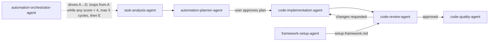

# .ai — skills, agents and repo context

| Folder | Contents |
|---|---|
| `context/` | All repo rules and learnings, tool-agnostic. `CLAUDE.md` (Claude Code) and `AGENTS.md` (Codex, Cursor, Copilot, Gemini CLI, …) are thin pointers to it. Edit here, never in those entry files. |
| `skills/` | Step-by-step procedures (`<name>/SKILL.md`). |
| `agents/` | Agent roles, one per skill, that run their skill autonomously and report back. Frontmatter uses the Claude Code subagent format; the body is plain instructions for any tool. |

Claude Code natively discovers skills/agents only from `.claude/skills` and `.claude/agents`, which are
symlinks to the folders here (`.claude/` is gitignored — recreate them after cloning). Other tools
read the files directly as instructed by `AGENTS.md`:

```bash
mkdir -p .claude && ln -s ../.ai/skills .claude/skills && ln -s ../.ai/agents .claude/agents
```

## Context files

| File | What it holds |
|---|---|
| `context/ai-assistant-instructions.md` | Start here: tool-agnostic entry, reading order, terminology (sandbox override, asking the user), skills/agents catalogue, per-tool wiring |
| `context/ui-automation-workflow.md` | Non-negotiable `playwright-cli` headless-exploration rules for pages and APIs, evidence conventions |
| `context/test-tagging.md` | `tag` option usage, classification + unique scenario tags |
| `context/automation-pipeline-learnings.md` | Sandbox override for test runs, version checks, env-var patterns, locator pitfalls, known environment gaps |
| `context/framework-design-principles.md` | Principles a–j, rule summary, artifact locations, pipeline diagram |

## Skills and agents

| Step | Skill | Agent | Input → Output |
|---|---|---|---|
| 0 | `orchestrate-automation` | `automation-orchestrator-agent` | SDET requirement → runs steps 1–4 in up to 5 cycles until every review score ≥ 4 (else `docs/reports/<slug>-task-abort-report.md`), then step 5 → learnings + `docs/reports/<slug>-orchestration-summary.md` |
| 1 | `analyze-task` | `task-analysis-agent` | task text/link → `docs/requirements/<slug>-requirements.md` |
| 2 | `plan-automation-code-changes` | `automation-planner-agent` | requirements/URLs/API docs → `docs/exploration/<slug>-exploration.md`, `docs/plans/<slug>-plan.md` |
| 3 | `make-code-changes` | `code-implementation-agent` | plan md → code + `docs/reports/<slug>-implementation-summary.md` |
| 4 | `review-code-changes` | `code-review-agent` | change-list md → `docs/reports/<slug>-review.md` (scores 1–5) |
| 5 | `check-code-quality` | `code-quality-agent` | codebase → `docs/reports/code-quality-<date>.md` |
| — | `setup-playwright-automation-framework` | `framework-setup-agent` | answers I–IV → `docs/plans/framework-setup-plan.md` (approval) → changes + `docs/setup-framework.md` |
| — | `write-linkedin-learning-post` | `linkedin-post-writer-agent` | repository (+ optional topic, role, audience, series history) → LinkedIn post draft with evidence table; optional `docs/linkedin-posts/<date>-<slug>.md`. Never publishes. |
| — | `playwright-cli` | — | browser task (open, snapshot, click, mock, trace, …) → drives a real browser, always headless; the required tool for exploring pages and APIs (see `ui-automation-workflow.md`). Vendor skill: reinstall with `playwright-cli install --skills`, then move it back here. |



End-to-end runs: in Claude Code, run `/orchestrate-automation <requirement>` in the main session (a
sub-agent can't start other sub-agents, so the orchestrator needs the main session to delegate);
in other tools, "follow `.ai/agents/automation-orchestrator-agent.md` for <requirement>".
Its flow diagram is in that agent file.

Usage: in Claude Code, `/analyze-task <task>` or "use the task-analysis-agent on …"; in other tools,
"follow `.ai/skills/analyze-task/SKILL.md` for <task>".
Skills ask questions interactively; agents return unanswered questions to the caller instead of guessing.
