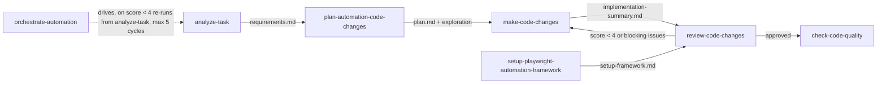

# Framework Design Principles (a–j)

Shared reference for every skill and agent under `.ai/`. Plans, implementations and
reviews in this repo are judged against these ten principles. Where a principle has a
concrete convention already established in this repo, it is listed under **In this repo**.

| # | Principle | What it means for Playwright + TypeScript | In this repo |
|---|---|---|---|
| a | Layered / Modular Architecture | Page Object Model (or Screenplay), fixtures layer, API client layer, data layer, utils — specs only orchestrate. | `pages/`, `fixtures/index.ts`, `api/clients/`, `api/helpers/`, `data/`, `utils/` |
| b | Reusability | Shared fixtures via `test.extend`, reusable locators/components, builders for data. No per-file `beforeEach` duplication. | All specs import `{ test, expect }` from `fixtures/` |
| c | Flexibility / Configurability | `playwright.config.ts` projects, `.env`, a typed config module. Nothing reads `process.env` directly except the config module. | `config/env.ts` (Zod-validated); one `<SITE>_BASE_URL` per target site |
| d | Ease of Understanding / Readability | TypeScript strict mode, ESLint (flat config) + Prettier, descriptive test titles. | `tsconfig.json` strict, `eslint.config.mjs`, `.prettierrc` |
| e | Maintainability | Centralized locators in page objects; prefer `getByRole`/`getByLabel`/`data-testid`/`data-test` over brittle CSS/XPath. | Locators live only in `pages/**`; heading locators scoped by `level` |
| f | Scalability | `fullyParallel`, workers, sharding, tagging. | Every test has a `tag` array: classification tag + unique scenario tag |
| g | Robustness / Reliability | Auto-waiting and web-first assertions, no `waitForTimeout`/hard sleeps, retries on CI, isolated test state per test. | `retries: process.env.CI ? 2 : 0` |
| h | Reporting & Traceability | HTML reporter, trace/video/screenshot on failure, JUnit/Allure for CI. | HTML + JUnit (`reports/junit-results.xml`) |
| i | Security & Data Hygiene | No committed secrets, `.env` gitignored, `.env.example` documented, synthetic data (Faker). Never paste tokens in chat. | `.env.example`, `data/builders/` |
| j | CI/CD Integration Readiness | Working pipeline file, headless execution in CI, browser install caching / official Playwright Docker image pinned to the installed version. | `Jenkinsfile` |

## Non-negotiable repo rules (summary)

The full, authoritative text lives in `ui-automation-workflow.md`, `test-tagging.md` and
`automation-pipeline-learnings.md` in this folder — always re-read those before acting, as they
may have grown since this summary was written. In short:

1. **Explore before you write UI code.** Explore every page and API involved with `playwright-cli`,
   always in **headless** mode (`open` without `--headed`), saving evidence to
   `docs/exploration/<feature-slug>-exploration.md`. `plan-automation-code-changes` and
   `review-code-changes` do this first. Never guess locators, and never use `npx playwright codegen`.
2. **Never run `npx playwright test` inside the default command sandbox.** Run with the
   sandbox override from the start (Chromium `ProcessSingleton` and `ENOTFOUND` errors are
   sandbox artifacts, not real failures).
3. **Tagging.** Every test uses the `tag` option (`test('title', { tag: ['@smoke', '@unique-scenario'] }, ...)`),
   never inline `@tag` text in the title. Each test has one unique kebab-case scenario tag
   that is not reused anywhere else.
4. **New target site → new `<SITE>_BASE_URL`** in `config/env.ts` + `.env.example`; never
   repoint the shared `BASE_URL`.
5. **Don't raw-concatenate paths onto a base URL** — use an explicit separator or normalize
   the trailing slash.
6. **Check installed tool versions** (`package.json` / `package-lock.json`) before pinning
   any version in a config (Docker tags, `moduleResolution`, ESLint config format).
7. **ESLint is flat-config only** (`eslint.config.mjs`).
8. **Verification = `npx tsc --noEmit` + `npx eslint <files>` + `npx prettier --check <files>`.**
9. **Known environment gaps are not code defects** (e.g. `@api-fetch-user-by-id` /
   `@api-create-user` need a real `/auth/login` backend; no Sonar server configured yet).

## Standard artifact locations

| Artifact | Path |
|---|---|
| Requirements (analyze-task) | `docs/requirements/<feature-slug>-requirements.md` |
| Exploration output | `docs/exploration/<feature-slug>-exploration.md` |
| Code change plan (plan-automation-code-changes) | `docs/plans/<feature-slug>-plan.md` |
| Framework setup plan | `docs/plans/framework-setup-plan.md` |
| Framework setup change log | `docs/setup-framework.md` |
| Implementation summary (make-code-changes) | `docs/reports/<feature-slug>-implementation-summary.md` |
| Code review report (review-code-changes) | `docs/reports/<feature-slug>-review.md` |
| Code quality report (check-code-quality) | `docs/reports/code-quality-<YYYY-MM-DD>.md` |

## Pipeline

