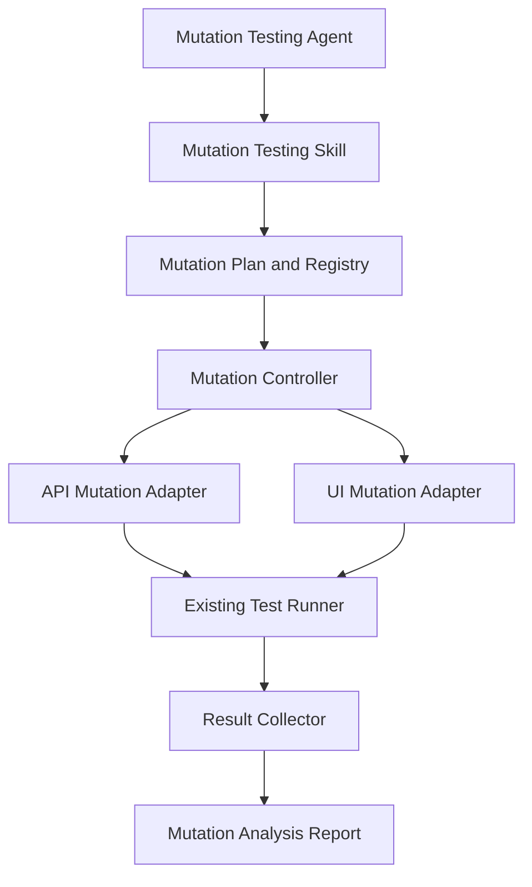

# Prompt: Build a Model-Agnostic Mutation Testing Skill and Agent for API and UI Automation

## 1. Role and Mission

Act as a Principal Test Automation Architect, Mutation Testing Engineer, and AI Agent Platform Engineer.

Analyze the existing software test automation repository and create:

1. A reusable **Mutation Testing Skill** containing the domain knowledge, workflows, mutation catalogs, implementation guidelines, and validation rules required to introduce controlled mutations.
2. A dedicated **Mutation Testing Agent** that uses this skill to identify mutation opportunities, implement or activate mutation hooks, execute existing tests in mutation mode, and analyze the results.
3. A configurable mutation infrastructure supporting both API and UI automation.
4. A reporting mechanism that evaluates whether existing tests, including AI-generated test cases, detect the defects introduced by mutations.

The implementation must be model-agnostic. It must not depend on a specific LLM provider, proprietary agent framework, or coding assistant.

Use the repository's existing technology stack and conventions wherever possible.

Do not rebuild the existing automation framework. Extend it with the smallest maintainable set of changes.

---

## 2. Core Objective

Enable mutation testing for existing API and UI automation tests by introducing controlled, deterministic, reversible mutations during test execution.

The system must answer:

- Can the existing test detect an incorrect API response?
- Can the existing test detect incorrect UI content or element state?
- Can the existing test detect broken UI interactions?
- Can the existing test detect visual regressions introduced by a mutation?
- Which assertions detect each mutation?
- Which mutations survive, and what test coverage gaps do they reveal?
- Can AI-generated tests be improved based on surviving mutations?

**Fundamental requirement:** A mutation must represent an intentional defect. The test suite must not be modified merely to make it fail when a mutation is introduced.

Existing tests should run through their normal execution paths, with mutation hooks activated externally through configuration, runtime context, or a dedicated mutation runner.

---

## 3. Repository Discovery and Compatibility

Before creating files or modifying code, inspect the repository.

Discover:

- Programming languages and build systems.
- API automation libraries and HTTP clients.
- UI automation libraries, browser drivers, and interaction patterns.
- Existing test runners and test discovery mechanisms.
- API specifications, schemas, fixtures, and business-rule definitions.
- Authentication, authorization, and test data management.
- Existing mock servers, proxies, network interceptors, and browser routing mechanisms.
- Reporting and CI/CD integrations.
- Existing agent, skill, instruction, and plugin conventions, if present.

Determine which components can be reused and where mutation hooks can be inserted with minimal disruption.

If the repository already has an established skill or agent format, follow that format. Otherwise, create a portable, documented structure that can be adapted to different coding agents.

Do not assume the use of Playwright, Selenium, REST Assured, TestNG, pytest, or any particular programming language. Discover the actual stack first.

Produce a brief implementation plan before making significant changes.

---

## 4. Create the Mutation Testing Skill

Create a reusable skill named `mutation-testing`.

The skill must contain the knowledge and procedures necessary for another agent or developer to perform mutation testing consistently.

Include the following responsibilities.

### 4.1 Skill responsibilities

- Discover API and UI automation entry points.
- Identify existing assertions and their expected behavior.
- Discover candidate mutation points.
- Select mutations based on requirements, contracts, schemas, and business rules.
- Generate mutation definitions and hooks.
- Configure mutation execution.
- Validate that each mutation is deterministic and reversible.
- Execute tests against individual mutations.
- Classify mutation outcomes.
- Identify surviving mutations and missing assertions.
- Generate a mutation analysis report.
- Recommend test improvements without silently changing the expected behavior.

### 4.2 Skill documentation

Document:

- Mutation testing concepts and terminology.
- Supported mutation categories.
- Framework-specific hook implementations.
- Configuration options.
- Safety restrictions.
- Mutation lifecycle.
- Test isolation and cleanup requirements.
- Result classification rules.
- Reporting format.
- Troubleshooting guidance.
- Procedures for adding new mutation operators.

Keep the skill modular. Put detailed framework-specific guidance in separate reference files instead of creating one excessively large instruction file.

### 4.3 Skill portability

Avoid hardcoding assumptions about a specific LLM, agent runtime, or proprietary tool.

Use ordinary Markdown instructions, portable configuration formats, and scripts or source files supported by the discovered repository.

Where agent runtimes require different metadata or file locations, document the minimal adapter needed to install or invoke the skill.

---

## 5. Create the Mutation Testing Agent

Create a dedicated agent named `mutation-testing-agent`.

The agent must use the mutation-testing skill and be responsible for orchestrating the mutation testing lifecycle.

### 5.1 Agent responsibilities

1. Analyze the existing test repository.
2. Identify test cases that can be evaluated through mutation testing.
3. Determine relevant mutation operators from available API contracts, UI behavior, and business rules.
4. Check whether suitable mutation hooks already exist.
5. Generate new hooks only when necessary.
6. Register hooks with the mutation controller.
7. Activate exactly the selected mutation for a test execution.
8. Execute the relevant existing tests.
9. Collect test outcomes and supporting evidence.
10. Classify each mutation result.
11. Identify surviving mutations and likely test gaps.
12. Generate a report and recommendations.

The agent must distinguish between creating mutation infrastructure and executing mutation campaigns. It should support both tasks independently.

### 5.2 Agent operating modes

Support the following modes:

**ANALYZE**
- Inspect the repository.
- Identify possible mutation points.
- Produce a mutation plan.
- Do not modify files.

**GENERATE**
- Create mutation definitions and missing hooks.
- Do not execute the complete test suite unless requested.

**VALIDATE**
- Verify that hooks compile or load, are scoped correctly, and can be activated and deactivated.
- Execute focused validation tests.

**RUN**
- Execute selected mutations against existing tests.
- Capture outcomes and evidence.

**REPORT**
- Analyze existing mutation results and produce a report.
- Do not change source code or test cases.

**IMPROVE**
- Recommend or implement additional assertions or test cases for surviving mutations.
- Keep test improvements separate from mutation infrastructure.
- Preserve the original test intent and independently sourced expected values.

Do not assume the agent runtime supports native named subagents. If it does not, implement these modes as explicit workflows within the agent instructions.

---

## 6. Mutation Hook Architecture

Design a shared mutation controller with separate API and UI mutation adapters.

The logical architecture should be:



Use existing infrastructure when suitable. Do not introduce an HTTP proxy, mock server, browser extension, or additional service unless the existing framework cannot support the required behavior.

### 6.1 Mutation lifecycle

Each mutation must follow this lifecycle:

1. Discover the candidate mutation point.
2. Create a mutation definition.
3. Validate the target and preconditions.
4. Register the mutation.
5. Enable mutation mode explicitly.
6. Activate one selected mutation.
7. Run the relevant existing test.
8. Capture the outcome and supporting evidence.
9. Disable the mutation.
10. Restore any changed state and clean up.
11. Verify that the next test begins without residual mutation effects.

Mutation hooks must not remain active across unrelated tests, browser contexts, sessions, or executions.

### 6.2 Hook activation

Support configuration equivalent to:

```yaml
mutationTesting:
  enabled: false
  mode: targeted
  layers:
    api: true
    ui: true
  isolation:
    oneMutationPerExecution: true
    restoreStateAfterExecution: true
  reporting:
    captureEvidence: true
    includeSurvivingMutations: true
```

Adapt the schema to the repository's configuration conventions.

Support activation through an environment variable, command-line option, or test-runner configuration.

When mutation mode is disabled, the application and test behavior must remain unchanged.

When mutation mode is enabled but no mutation is selected, fail safely or execute the explicitly documented baseline mode. Never activate random mutations silently.

---

## 7. API Mutation Hooks

Implement API mutation hooks using the most appropriate existing interception point.

Possible mechanisms include:

- HTTP client interceptors.
- Test fixtures or middleware.
- Browser network routing.
- Controlled reverse proxies.
- Mock or service virtualization layers.
- Test-environment response adapters.

Prefer the least invasive mechanism that works with the existing framework.

### 7.1 API mutation categories

Implement an extensible catalog covering:

**Response body**
- Replace a field value with an incorrect value.
- Remove a required field.
- Change a field's type.
- Change a nested object or array.
- Return an incorrect record or identifier.
- Duplicate or omit records.
- Corrupt a business-rule-derived value.

**HTTP behavior**
- Return an incorrect status code.
- Return a valid but unexpected status code.
- Modify a response header.
- Remove a required header.
- Return an incorrect content type.
- Return an empty or malformed body.

**Boundary and business behavior**
- Violate a documented boundary condition.
- Return an incorrect pagination result.
- Ignore a filter or sorting parameter.
- Return stale or inconsistent test data.
- Apply an incorrect calculation result.

**Security-related behavior**
- Simulate unauthorized access to a protected resource.
- Simulate cross-user or cross-tenant data leakage in an isolated test environment.
- Alter security-relevant response properties.

Do not interpret a response-only mutation as proof that backend authorization, business logic, or database behavior was exercised incorrectly. Record the mutation layer accurately.

### 7.2 API mutation definition

Use a portable definition equivalent to:

```json
{
  "id": "API-BALANCE-001",
  "layer": "api",
  "target": {
    "method": "GET",
    "path": "/api/accounts/{id}/balance"
  },
  "operator": "replace_json_value",
  "selector": "$.balance",
  "value": 0,
  "preconditions": {
    "contentType": "application/json"
  },
  "scope": {
    "testId": "account-balance-test"
  },
  "enabled": true
}
```

This is an illustrative schema. Adapt it to the actual implementation and validate every definition before use.

### 7.3 API hook requirements

- Match requests using method, normalized path, and optional query parameters.
- Support safe handling of dynamic path parameters.
- Allow mutations to be restricted to a particular test or execution.
- Preserve the original response when the mutation does not match.
- Avoid mutating unrelated API calls.
- Handle compressed, streaming, binary, and multipart responses safely.
- Do not mutate responses that cannot be processed correctly; report them as unsupported.
- Prevent sensitive data from being written to logs or reports.
- Ensure that mutation execution cannot accidentally target production systems.

---

## 8. UI Mutation Hooks

Implement UI mutation hooks that target rendered application behavior rather than modifying test assertions.

Use the existing UI automation library and its supported browser capabilities.

### 8.1 UI mutation categories

**Content and DOM**
- Change visible text.
- Change accessible names.
- Change element attributes.
- Remove a required element.
- Hide an element.
- Disable a control.
- Introduce an incorrect displayed value.
- Change table content or ordering.

**Interaction**
- Prevent a button from performing its expected action.
- Cause a dropdown to expose an incorrect option.
- Simulate a failed modal opening.
- Simulate a nonfunctional pagination or sorting control.
- Simulate an invalid form submission being accepted or a valid submission being rejected.

**Visual**
- Change color, typography, spacing, or dimensions.
- Introduce an element offset.
- Create a controlled overlap.
- Hide an important visual element.
- Introduce a responsive layout defect.

### 8.2 UI mutation mechanisms

Choose the mechanism appropriate to the target:

- DOM manipulation for content and attribute mutations.
- CSS overrides for styling and layout mutations.
- Browser network routing for mutations originating from API responses.
- Test-only application hooks or controlled frontend instrumentation for interaction mutations.
- Application build variants or source-level mutations when actual frontend logic must be changed.

Do not claim that changing DOM text proves that the application's underlying event handler is broken. Choose a mutation mechanism that accurately represents the intended defect.

### 8.3 UI targeting

Use the strongest available target identifiers in this order where appropriate:

1. Stable test IDs or explicit mutation IDs.
2. Semantic attributes and accessible roles.
3. Stable application-specific identifiers.
4. Carefully constrained CSS selectors.
5. Positional or coordinate-based targeting only when no reliable alternative exists.

Require a unique target unless the mutation explicitly supports multiple targets.

If a target cannot be resolved uniquely, skip the mutation with a clear diagnostic rather than mutating an arbitrary element.

### 8.4 UI mutation definition

Use a portable definition equivalent to:

```json
{
  "id": "UI-SUBMIT-001",
  "layer": "ui",
  "target": {
    "route": "/contact",
    "testId": "contact-submit-button"
  },
  "operator": "change_accessible_name",
  "value": "Cancel",
  "scope": {
    "testId": "contact-form-test"
  },
  "enabled": true
}
```

Adapt this schema to the existing application and automation framework.

### 8.5 UI hook requirements

- Apply mutations deterministically.
- Scope mutations to the intended page, component, browser context, and test execution.
- Avoid introducing persistent changes into shared application data.
- Preserve normal browser interactions except where the selected mutation intentionally changes them.
- Support cleanup after test completion, navigation, and failure.
- Distinguish mutation-induced failures from browser crashes, network outages, and unrelated infrastructure failures.
- Ensure that UI hooks do not bypass the test's normal locators, actions, or assertions.

---

## 9. Existing Test Case Compatibility

The existing test cases are the evaluation subjects.

Do not require developers to rewrite each test to recognize mutation IDs or explicitly assert that a mutation has occurred.

The mutation controller must activate the selected defect externally, while tests continue using their normal execution flow.

For example:

Original test:

- Open an account page.
- Read the displayed balance.
- Assert that the balance equals the expected value.

Mutation:

- Change the balance returned by the relevant API from the correct value to zero.

Expected outcome:

- The test fails on the existing balance assertion.
- The mutation is classified as killed if the failure is attributable to the mutation.

If the test still passes, classify the mutation as surviving unless there is evidence of an unrelated failure or another invalid execution condition.

Where the existing framework requires an adapter or test fixture to activate hooks, implement it once in the shared infrastructure rather than adding mutation-specific logic to individual tests.

---

## 10. Baseline Validation and Mutation Outcomes

Every mutation campaign must establish a valid baseline.

Run the relevant test against the unmutated application first. Do not evaluate a mutation against a test that already fails in baseline execution.

Classify results using the following categories:

- **KILLED:** The test detects the mutation through a relevant assertion or an expected behavioral failure.
- **SURVIVED:** The test completes without detecting the mutation.
- **INVALID:** The mutation could not be applied, did not affect the intended target, or was not activated as expected.
- **INCONCLUSIVE:** The test outcome cannot reliably establish whether the mutation was detected.
- **TIMEOUT:** The execution exceeded the configured limit and requires investigation.
- **EQUIVALENT:** The mutation is confirmed to have no observable difference relevant to the intended behavior.

Do not classify every test failure as a killed mutation. Correlate the failure with the active mutation and verify that the test was healthy before mutation.

An equivalent mutation must not be declared solely because it survived.

---

## 11. Mutation Selection and Execution Strategy

Support:

- Targeted mutation selection.
- Mutation execution for a specific test.
- Mutation execution for a selected API endpoint or UI route.
- Full mutation campaigns.
- Deterministic seeds if randomized selection is supported.
- Configurable execution timeouts.
- Parallel execution only when isolation is guaranteed.

Initially, run one mutation per isolated test execution.

Group mutations into meaningful campaigns, such as:

- API response correctness.
- API schema and validation.
- UI content and accessibility.
- UI interactions.
- Visual regression.
- End-to-end API-to-UI behavior.

Avoid executing every mutation against every test unless that is explicitly requested. Use endpoint, route, dependency, and assertion information to reduce unnecessary executions.

If the framework supports test-to-endpoint dependency mapping, use it to select relevant tests.

---

## 12. Mutation Registry and Reporting

Maintain a registry containing:

- Mutation ID.
- Mutation layer.
- Mutation category and operator.
- Target endpoint, route, or element.
- Original and mutated values where safe.
- Activation and cleanup status.
- Related test IDs.
- Baseline result.
- Mutated execution result.
- Failure reason and evidence.
- Execution duration.
- Final classification.

Provide both machine-readable and human-readable reports.

### Required report sections

1. Campaign summary.
2. Baseline health.
3. Mutation counts by layer and category.
4. Killed mutations.
5. Surviving mutations.
6. Invalid and inconclusive mutations.
7. Test failures unrelated to mutations.
8. Likely missing assertions or scenarios.
9. Mutation application and cleanup errors.
10. Recommended improvements.

For every surviving mutation, include the relevant test ID, target, intended defect, observed behavior, and the missing assertion or scenario if it can be established.

Do not invent missing assertions without examining the test, requirements, and expected behavior.

---

## 13. Mutation Metrics

Calculate and report the conventional mutation score:

```text
Mutation Score = Killed Mutants / (Valid Non-Equivalent Mutants) × 100
```

Exclude invalid and equivalent mutants from the denominator. Report inconclusive results separately rather than silently counting them as killed.

Also report:

- Total mutations attempted.
- Valid mutations applied.
- Killed and surviving mutations.
- Mutation score by API/UI layer.
- Mutation score by category.
- Baseline test pass rate.
- Test execution time and cost.
- AI test improvement rate, when before-and-after campaigns exist.

Do not use mutation score as the only measure of AI-generated test quality. Report the scope of mutations and any known limitations.

---

## 14. AI-Driven Test Improvement

When a mutation survives:

1. Retrieve the relevant requirements, API contract, UI behavior specification, existing test, and assertion results.
2. Determine whether the mutation represents a meaningful defect.
3. Identify why the existing test did not detect it.
4. Recommend a specific additional assertion, test scenario, or behavioral check.
5. Preserve independent expected-value sources.
6. Generate a proposed test improvement.
7. Run the improved test against both baseline and the selected mutation.
8. Verify that the baseline still passes and the mutation is now detected.
9. Record the before-and-after result.

Do not automatically weaken assertions, change expected results to match mutated responses, or modify the mutation to force a successful score.

Keep AI-generated improvements reviewable and separate from production test changes.

---

## 15. Safety and Reliability Requirements

- Mutation testing must be opt-in.
- Never target production by default.
- Require an explicit environment allowlist or equivalent guard.
- Never mutate real customer data or execute destructive production operations.
- Restrict hooks to authorized test environments.
- Prevent cross-test mutation leakage.
- Ensure reliable cleanup, including after crashes and timeouts.
- Avoid exposing secrets, tokens, personal data, or sensitive response bodies in reports.
- Make mutation selection and execution auditable.
- Validate mutation definitions before activation.
- Do not disable TLS verification or weaken authentication globally to facilitate mutations.
- Do not alter normal test behavior when mutation mode is disabled.
- Ensure parallel campaigns cannot apply competing mutations to the same shared resource.

---

## 16. Testing the Mutation Infrastructure Itself

Create tests that verify the mutation framework independently of the application test suite.

Cover:

- Mutation activation and deactivation.
- Request and route matching.
- API response transformations.
- DOM and CSS mutation application.
- Interaction mutation behavior.
- Unsupported response handling.
- Missing and ambiguous targets.
- Test isolation and cleanup.
- Failure and timeout recovery.
- Configuration validation.
- Production-target prevention.
- Report generation and metric calculations.
- Baseline behavior when mutation mode is disabled.

Include at least one API example and one UI example demonstrating that an existing test kills a known mutation.

Include at least one surviving mutation example demonstrating how the report identifies a test gap.

---

## 17. Deliverables

Create the following logical deliverables, adapting their exact paths to the repository's conventions:

1. Mutation Testing Skill and its main instructions.
2. Supporting mutation operator and framework reference documentation.
3. Mutation Testing Agent instructions and operating modes.
4. Mutation controller.
5. API mutation adapter.
6. UI mutation adapter.
7. Mutation registry and configuration.
8. Mutation execution and cleanup lifecycle.
9. Result collector and reporting utilities.
10. Unit and integration tests for the mutation infrastructure.
11. Example API and UI mutation definitions.
12. Documentation covering installation, activation, execution, troubleshooting, and extension.
13. CI/CD integration instructions or an implementation where appropriate.

Do not create empty placeholder files and report the task as complete. Implement functional components appropriate to the repository.

---

## 18. Acceptance Criteria

The implementation is complete only when:

- The skill and agent are documented and discoverable using the repository's conventions.
- The system works without requiring a particular LLM provider.
- Existing API and UI tests run unchanged in normal mode.
- Mutation mode can be enabled explicitly and deterministically.
- At least one API response mutation is applied and detected by an existing test.
- At least one UI mutation is applied and detected by an existing test.
- At least one surviving mutation is correctly reported as a test gap.
- Invalid and inconclusive executions are not counted as killed.
- Mutation cleanup and test isolation are verified.
- Reports contain sufficient evidence to explain the outcome.
- Security and production-environment safeguards are tested.
- Documentation provides reproducible commands for running the examples.

---

## 19. Final Execution Instructions

Proceed in this order:

1. Inspect the repository and identify its conventions.
2. Present a concise architecture and implementation plan.
3. Create the mutation-testing skill.
4. Create the mutation-testing agent.
5. Implement the shared controller and the API/UI adapters.
6. Add configuration, registry, execution, and reporting.
7. Add focused tests for the mutation infrastructure.
8. Demonstrate an API mutation and a UI mutation against existing tests.
9. Verify baseline behavior, mutation cleanup, and test isolation.
10. Document the commands, limitations, and next steps.

At the end, provide a summary of files created or changed, the architecture implemented, commands to run mutation testing, validation results, unsupported mutation types, and any remaining limitations.

If a required capability is unsupported by the current framework, explain the limitation and implement the closest safe, maintainable alternative rather than claiming the feature is complete.

---

## 20. Change Request: Mutate Existing Test Cases (MUTATION_ENABLED)

Modify the model-agnostic mutation testing skill and agent to modify the existing test cases with mutations rather than creating new test cases. The mutation should run when the `MUTATION_ENABLED` property is set to `true`.

> **Note:** In expectations for mutations, the expectation must make the required assertion
> always **fail**, not pass. Add this to the mutation skill.
