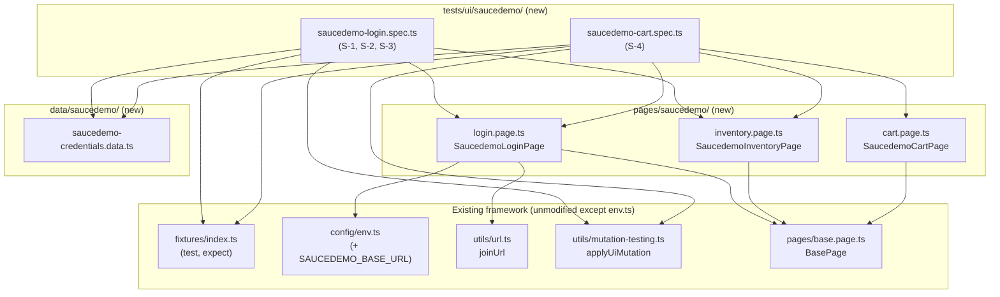
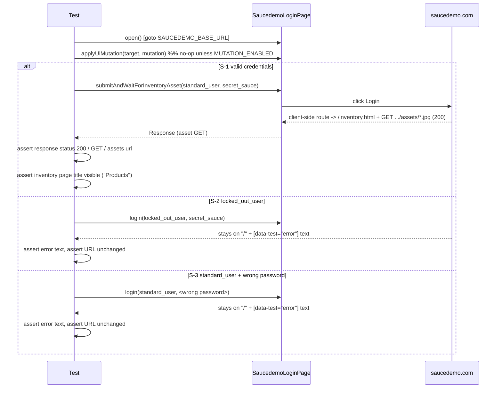
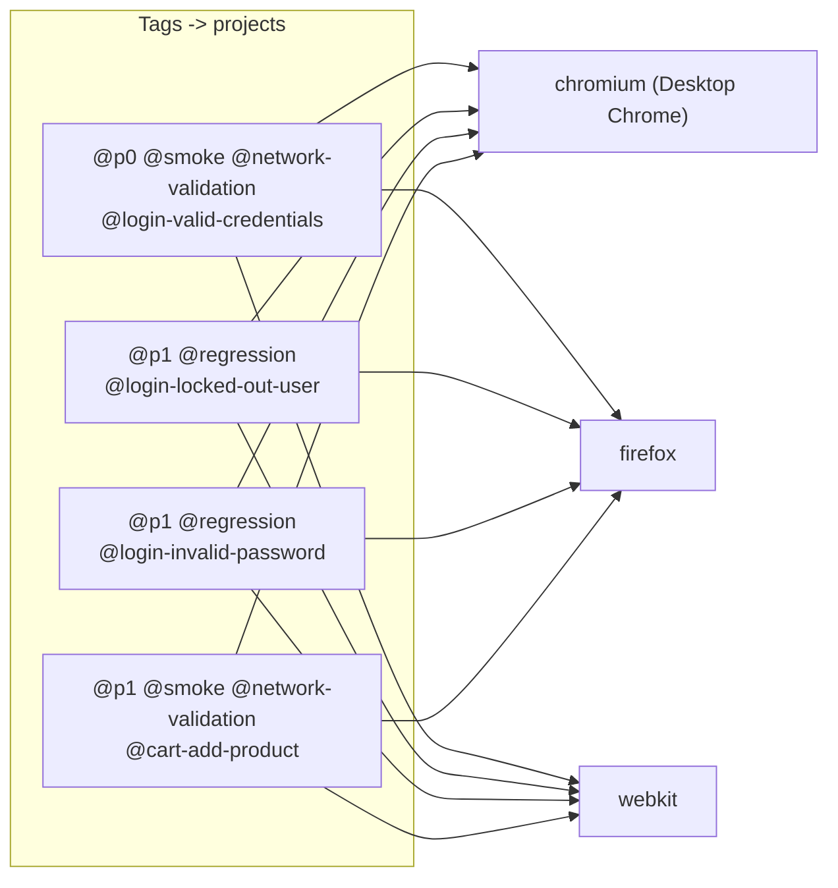

# SauceDemo Login & Add-to-Cart — Code Change Plan

Cycle: 1 (no prior review). Requirements: `docs/requirements/saucedemo-login-cart-requirements.md`.
Exploration: `docs/exploration/saucedemo-login-cart-exploration.md`. This plan adds four UI tests
from scratch; nothing is being restored.

## 1. Overview

**Goal:** add four Playwright UI tests against the live `https://www.saucedemo.com/` site: one
successful login, two failed logins (locked-out account, wrong password), and one add-to-cart flow,
each tagged exactly as specified, two of them (`@network-validation`) also asserting on real network
activity, and all four wired into the repo's existing `applyUiMutation` mutation-testing mechanism.

**In scope:** exactly the four test cases (S-1..S-4) in the requirements doc; a new `SAUCEDEMO_BASE_URL`
env var; page objects for the login, inventory and cart pages; a small SauceDemo credentials data
file; README/`.env.example`/`to_be_automated.md`/Jenkinsfile updates.

**Out of scope:** any other SauceDemo flow (checkout, remove, sort, other accounts, logout); new
browser projects; changes to the mutation mechanism itself; any other site's tests or env vars.

## 2. Inputs received

- Requirements doc `docs/requirements/saucedemo-login-cart-requirements.md` (AC-1..AC-12, Q-1..Q-5,
  all non-blocking with stated defaults) — treated as the primary source of goals.
- Exact test titles/tags for all four tests (verbatim, see requirements §Scenarios/§Classification).
- Repo conventions read directly from the codebase: `fixtures/index.ts`, `config/env.ts`,
  `pages/base.page.ts`, `pages/example.page.ts`, `utils/url.ts`, `utils/mutation-testing.ts`,
  `playwright.config.ts`, `tests/ui/example.spec.ts`, `data/builders/example.builder.ts`,
  `data/framework/shared-browser.data.ts`, `.env.example`, `README.md`, `Jenkinsfile`.
- Live exploration of `https://www.saucedemo.com/` via `playwright-cli` (headless, Desktop Chrome;
  see exploration doc) — the actual source of every locator, error-message string and
  network-validation finding below. No sample/mock data was used; the live site was reachable
  throughout.

## 3. Exploration findings (summary — full detail and raw command output in the exploration doc)

- Login page (`/`): `[data-test="username"]`, `[data-test="password"]`, `[data-test="login-button"]`,
  `[data-test="error"]`. Public demo accounts confirmed on-page: `standard_user`, `locked_out_user`,
  password `secret_sauce` for all.
- Valid login → `/inventory.html` (client-side route change, no document request). Error texts
  confirmed verbatim: locked-out → `"Epic sadface: Sorry, this user has been locked out."`; wrong
  password → `"Epic sadface: Username and password do not match any user in this service"`. Both
  stay at `/` (no navigation) — distinct strings, satisfying AC-5.
- Inventory page: page title `[data-test="title"]` = `"Products"`; "Sauce Labs Backpack"'s
  "Add to cart" button is `[data-test="add-to-cart-sauce-labs-backpack"]`; cart badge
  `[data-test="shopping-cart-badge"]` is **absent from the DOM when empty**, appears with text `"1"`
  after one add; header cart link's accessible name becomes `"Cart, 1 items"` (literally "1 items").
- Cart page (`/cart.html`): page title `[data-test="title"]` = `"Your Cart"`; item name
  `[data-test="inventory-item-name"]` = `"Sauce Labs Backpack"`; no product image rendered here.
- **Network-validation (the key finding):** SauceDemo is a 100%-client-side SPA. Login and
  add-to-cart never hit a backend API or even a document navigation. The only non-static traffic
  (`events.backtrace.io` analytics, always `401`) is a timer-batched heartbeat **not** caused by any
  specific click (confirmed: it fired after `fill`/login-click but did **not** fire at all after the
  add-to-cart click) — unsuitable, flaky if used. The one real, deterministic, action-caused network
  signal found is: a successful login causes the client to render the inventory grid, whose ``
  tags then issue `GET https://www.saucedemo.com/assets/*.jpg` requests (confirmed `200`, captured
  with `page.waitForResponse()` racing the login click, not a post-hoc check). **Add-to-cart itself
  produces zero network requests of any kind** — confirmed by diffing the full request list
  before/after; this is a genuine gap, reported per Q-2/A-2 rather than invented. See plan §11 for
  how test 4 handles this.

## 4. Diagrams

### Structure



### Workflow — S-1 / S-2 / S-3 (login)



### Workflow — S-4 (add to cart)

```mermaid
sequenceDiagram
  participant T as Test
  participant LP as SaucedemoLoginPage
  participant IP as SaucedemoInventoryPage
  participant CP as SaucedemoCartPage
  participant Site as saucedemo.com

  T->>LP: open() [goto SAUCEDEMO_BASE_URL]
  T->>LP: submitAndWaitForInventoryAsset(standard_user, secret_sauce)
  Site-->>LP: GET .../assets/sauce-backpack-*.jpg (200)
  T->>T: assert response status 200 (network-validation signal; login precondition, see §11)
  T->>IP: applyUiMutation(cartPage.itemName OR inventory target, mutation)
  T->>IP: addBackpackToCart()
  Note over Site: confirmed: zero network requests from this click
  T->>IP: openCart()
  Site-->>CP: client-side route -> /cart.html (no network request)
  T->>T: assert cart item name "Sauce Labs Backpack" visible
  T->>T: assert cart badge text "1"
```

### Execution



All four tests also carry `@mutation-target`, so `MUTATION_ENABLED=true` (local-only, forbidden in
CI by `playwright.config.ts`) filters the UI projects down to just these four (plus any other
`@mutation-target` tests, e.g. the existing homepage one).

## 5. Test-case matrix

| ID | Scenario | Type | Data | Assertions | Tags | Project(s) | Source |
|---|---|---|---|---|---|---|---|
| S-1 | Valid login reaches inventory | Positive + network | `standard_user` / `secret_sauce` | URL is `/inventory.html`; `[data-test="title"]` visible with text `Products`; `GET .../assets/*.jpg` response status `200` | `@p0`, `@smoke`, `@network-validation`, `@mutation-target`, `@login-valid-credentials` | chromium, firefox, webkit | AC-1, AC-2, E-2/E-6 |
| S-2 | Locked-out user blocked | Negative | `locked_out_user` / `secret_sauce` | `[data-test="error"]` visible, text exactly `"Epic sadface: Sorry, this user has been locked out."`; URL unchanged (`/`) | `@p1`, `@regression`, `@mutation-target`, `@login-locked-out-user` | chromium, firefox, webkit | AC-3, AC-5, E-3 |
| S-3 | Wrong password for `standard_user` | Negative | `standard_user` / Faker-generated wrong password | `[data-test="error"]` visible, text exactly `"Epic sadface: Username and password do not match any user in this service"`; URL unchanged (`/`) | `@p1`, `@regression`, `@mutation-target`, `@login-invalid-password` | chromium, firefox, webkit | AC-4, AC-5, E-4 |
| S-4 | Add product, shows on cart page | Positive + state + network | `standard_user` / `secret_sauce`; product "Sauce Labs Backpack" | Login's `GET .../assets/*.jpg` response status `200` (network-validation; see §11 for why this, not the add-to-cart click itself); cart item name visible = `"Sauce Labs Backpack"`; cart badge text = `"1"` | `@p1`, `@smoke`, `@network-validation`, `@mutation-target`, `@cart-add-product` | chromium, firefox, webkit | AC-6, AC-7, E-5/E-6 |

No parametrization across rows is used (four distinct named scenarios, not a data-driven set per
the requirements doc's exact-title mandate); each test is written individually so each keeps its own
literal `tag` array (required for `playwright/valid-test-tags`, see §9).

**Candidate cases — needs confirmation (not in scope, listed for completeness only):** `problem_user`,
`performance_glitch_user`, `error_user`, `visual_user` logins; removing a cart item; checkout; cart
badge pluralization ("1 items" is odd copy but confirmed verbatim, not a bug this plan fixes). None
of these are implemented — out of scope per requirements §2.

## 6. Code change list

| File | Action | Responsibilities | Principle(s) |
|---|---|---|---|
| `config/env.ts` | Modify | Add `SAUCEDEMO_BASE_URL: z.string().url()` to `envSchema` | c |
| `.env.example` | Modify | Add `SAUCEDEMO_BASE_URL=https://www.saucedemo.com` with a comment, grouped near `BASE_URL` | c, i |
| `data/saucedemo/saucedemo-credentials.data.ts` | Create | Exports `SAUCEDEMO_USERS = { standardUser: { username: 'standard_user', password: 'secret_sauce' }, lockedOutUser: { username: 'locked_out_user', password: 'secret_sauce' } }` (public demo values, literal) and `buildWrongPassword(): string` (Faker-backed, guaranteed non-empty, non-real value) for S-3 | a, b, i |
| `data/saucedemo/saucedemo-product.data.ts` | Create | Exports `SAUCEDEMO_BACKPACK = { name: 'Sauce Labs Backpack', addToCartTestId: 'add-to-cart-sauce-labs-backpack' }` — the one product S-4 uses | a, b |
| `pages/saucedemo/login.page.ts` | Create | `SaucedemoLoginPage extends BasePage`: locators `usernameInput`, `passwordInput`, `loginButton`, `errorMessage`; methods `open(): Promise<void>` (`goto(joinUrl(env.SAUCEDEMO_BASE_URL))`), `login(username: string, password: string): Promise<void>`, `submitAndWaitForInventoryAsset(username: string, password: string): Promise<import('@playwright/test').Response>` (the `Promise.all([waitForResponse(...), loginButton.click()])` pattern from E-6, encapsulated here so specs never touch `waitForResponse` directly) | a, e |
| `pages/saucedemo/inventory.page.ts` | Create | `SaucedemoInventoryPage extends BasePage`: locators `pageTitle`, `cartLink`, `cartBadge`, `backpackAddToCartButton` (keyed off `SAUCEDEMO_BACKPACK.addToCartTestId`); methods `addBackpackToCart(): Promise<void>`, `openCart(): Promise<void>` | a, e |
| `pages/saucedemo/cart.page.ts` | Create | `SaucedemoCartPage extends BasePage`: locators `pageTitle`, `cartBadge`, `backpackItemName` (`[data-test="inventory-item-name"]`, scoped to the single row expected) | a, e |
| `tests/ui/saucedemo/saucedemo-login.spec.ts` | Create | 3 tests: S-1 (`logs in with valid credentials and lands on the inventory page`), S-2 (`shows an error and stays on the login page for locked_out_user`), S-3 (`shows an error and stays on the login page for standard_user`) — exact titles/tags per requirements; each calls `applyUiMutation` before/around its own primary assertion target | b, d, e, g |
| `tests/ui/saucedemo/saucedemo-cart.spec.ts` | Create | 1 test: S-4 (`adds a product to the cart and shows it on the cart page`) — exact title/tags; logs in via `submitAndWaitForInventoryAsset` (reused network-validation signal, see §11), adds backpack, opens cart, asserts; calls `applyUiMutation` on the cart item name | b, d, e, g |
| `README.md` | Modify | Add `SAUCEDEMO_BASE_URL` row to the env-var table (§"Environment variables"); one line under "Notes" documenting that the SauceDemo add-to-cart action itself has no observable network signal on this site (so its `@network-validation` test validates the login precondition instead — cross-reference the exploration doc) | d, h |
| `Jenkinsfile` | Modify | Add `SAUCEDEMO_BASE_URL = 'https://www.saucedemo.com'` as a plain (non-`credentials()`) env var in the `environment` block — it is a public URL, not a secret, so no new Jenkins credential binding is needed | c, i, j |
| `to_be_automated.md` | Modify | No change needed if currently empty of this item (confirmed: file already says "No scenarios are queued right now" — SauceDemo login/cart is not listed as pending, so nothing to remove); left as-is unless review finds otherwise |  |

No existing file under `tests/`, `pages/`, `fixtures/`, `api/`, `data/`, `utils/` other than the new
SauceDemo-specific files is touched; `config/env.ts` gets one additive schema field.

## 7. Tagging plan

- Classification tags used: `@p0`, `@p1`, `@smoke`, `@regression`, `@network-validation`,
  `@mutation-target`. Checked via `grep -rn "@p0\|@p1\|@smoke\|@regression\|@mutation-target"
  tests/`: `@smoke` and `@mutation-target` are already used elsewhere (`tests/ui/example.spec.ts`);
  `@regression` is already used elsewhere (`tests/ui/framework/*.spec.ts`, alongside `@p3`);
  `@network-validation` is new to the repo but is a classification category, not a unique tag, so no
  collision check applies the same way. `@p0` and `@p1` are **not** currently used anywhere in the
  repo (only `@p2`/`@p3` exist, on the homepage example test and the framework verification tests
  respectively) — this plan introduces the `@p0`/`@p1` priority levels for the first time, exactly as
  the requirements doc's table specifies; this is expected, not a conflict, since priority tags are a
  shared scale, not unique-per-test tags, but is noted here for the SDET's awareness.
- Unique scenario tags: `@login-valid-credentials`, `@login-locked-out-user`,
  `@login-invalid-password`, `@cart-add-product`. Checked for collisions:
  `grep -rn "@login-\|@cart-add-product" tests/` → no existing matches (only this plan introduces
  them). None is reused across the four tests.
- All four use the `tag` test option (array literal directly in the `test(...)` call, not a variable
  — see `playwright/valid-test-tags` note in §9), never inline `@tag` text in the title string.
- Grep commands to run subsets:
  ```bash
  npx playwright test --grep @login-valid-credentials --project=chromium
  npx playwright test --grep "@login-locked-out-user|@login-invalid-password" --project=chromium
  npx playwright test --grep @cart-add-product --project=chromium
  npx playwright test --grep "@login-valid-credentials|@login-locked-out-user|@login-invalid-password|@cart-add-product"
  ```

## 8. Test data & security

- `standard_user` / `locked_out_user` / `secret_sauce` are the site's own public demo credentials
  (confirmed on-page, E-1) — not secrets, no `.env` entry needed for them (per Q-5/A-5), stored as
  literal constants in `data/saucedemo/saucedemo-credentials.data.ts`.
- S-3's wrong password is Faker-generated (`faker.internet.password(...)`) at test-data-build time,
  consistent with `data/builders/example.builder.ts`'s existing pattern, so no hardcoded "wrong"
  value drifts into looking like a real password; a short runtime guard
  (`!== SAUCEDEMO_USERS.standardUser.password`) makes the builder regenerate if Faker ever
  coincidentally produced the real password (astronomically unlikely but checked, not assumed).
- `SAUCEDEMO_BASE_URL` is a public URL (`https://www.saucedemo.com`), documented in `.env.example`
  with no secret value; Jenkins gets it as a plain env var, not a credential binding (§6).
- No PII, no production data, no tokens are introduced or printed anywhere in specs, page objects or
  the exploration doc (the exploration doc's `events.backtrace.io` snippets already show literal
  placeholder `UNIVERSE`/`TOKEN` strings taken verbatim from the site's own broken config — not real
  secrets).

## 9. Reliability notes

- No `waitForTimeout`/hard sleeps anywhere; all waits are Playwright's auto-waiting web-first
  assertions (`expect(locator).toBeVisible()`, `toHaveText()`) or `page.waitForResponse()` raced
  against the triggering click (`Promise.all`), never a bare "wait then check".
- Each Playwright test gets its own fresh `BrowserContext`/`Page` per this repo's fixture model
  (`fixtures/index.ts`), so the cross-test cart-state persistence observed in E-7 (browser storage
  surviving a `goto` back to `/`) cannot leak between tests; S-4 starts from a brand-new context so
  its cart is empty before the add.
- Flakiness risk flagged and mitigated: the `events.backtrace.io` analytics POSTs are a real but
  non-causal, timer-batched network signal (E-6 Finding 2) — explicitly **not** used for assertions,
  to avoid a flaky/non-deterministic test.
- S-1's and S-4's network assertion uses a URL-pattern regex (`/\/assets\/.*\.(jpg)$/i`) rather than
  the exact hashed filename (`sauce-backpack-1200x1500-CjRW-Djj.jpg`), because that hash is a build
  artifact name that can change on a future site deploy (same category of risk as the heading-copy
  drift already documented in `.ai/context/automation-pipeline-learnings.md`).
- Error-message assertions use the exact strings confirmed live (`toHaveText(...)`, not a loose
  regex) per AC-5's explicit requirement that the two messages be treated as distinct, confirmed
  text — this is intentionally less drift-tolerant than the heading-copy convention, matching what
  AC-5 asks for.
- `[data-test="inventory-item-name"]` on the cart page is only safe to assert as a single element
  because S-4 adds exactly one product in a fresh context; no `.first()`/filter needed, but the
  implementation should still assert `toHaveCount(1)` before asserting text, to fail clearly instead
  of silently matching zero or many elements if the page structure ever changes.
- Cross-browser: all locators are `data-test`-attribute based (no CSS/XPath, no role names tied to
  volatile copy except the error text, which is required exact copy), so chromium/firefox/webkit
  parity is expected; no browser-specific code is planned (per repo rule, no `browserName` branches).

## 10. Verification plan

Static checks (run on every changed/added file):

```bash
npx tsc --noEmit
npx eslint config/env.ts data/saucedemo/*.ts pages/saucedemo/*.ts tests/ui/saucedemo/*.spec.ts README.md Jenkinsfile
npx prettier --check config/env.ts data/saucedemo/*.ts pages/saucedemo/*.ts tests/ui/saucedemo/*.spec.ts .env.example README.md Jenkinsfile
```

Live test runs (sandbox override required from the start, per
`.ai/context/automation-pipeline-learnings.md`):

```bash
# Normal mode (MUTATION_ENABLED unset/false) — all four must pass
npx playwright test --grep "@login-valid-credentials|@login-locked-out-user|@login-invalid-password|@cart-add-product" --project=chromium

# Same, full matrix (chromium/firefox/webkit) once chromium is green
npx playwright test --grep "@login-valid-credentials|@login-locked-out-user|@login-invalid-password|@cart-add-product"

# Mutation mode (local only, never CI) — each of the four must now FAIL on its own targeted assertion
MUTATION_ENABLED=true npx playwright test --grep "@login-valid-credentials|@login-locked-out-user|@login-invalid-password|@cart-add-product" --project=chromium
```

All three `npx playwright test` commands must be run with this environment's sandbox override from
the start (not sandboxed-first), per the repo's mandatory rule.

## 11. Risks, assumptions, open questions

- **Open point — test 4's network-validation signal is borrowed from its own login step, not its
  add-to-cart click (needs SDET sign-off, non-blocking default already applied):** exploration
  (E-6) conclusively showed add-to-cart produces zero network requests on this site. Per the
  requirement's own Q-2/A-2 default, this plan reports that gap rather than inventing a signal, and
  reuses the same real, action-caused product-image GET (confirmed `200`) from S-4's own login
  precondition step to satisfy `@network-validation` on test 4. If the SDET instead wants test 4's
  network assertion dropped entirely (tag kept, no network assertion) or wants a different
  resolution (e.g., assert the *absence* of any new network activity after the add-to-cart click, as
  a different kind of "network validation"), say so and this plan's §5/§6/§9 for S-4 will be
  adjusted before implementation.
- **R-1 Third-party site drift** (requirements): `saucedemo.com` can change independently; the exact
  hashed image filename is already avoided (regex match) for this reason, but error-message copy and
  `data-test` attribute names are not — if the site changes those, these tests will need updating,
  which is expected/acceptable per the requirements doc's own framing.
- **Naming decision (Q-4 default applied):** mutation targets chosen are: S-1 → inventory page title
  (`hide`); S-2/S-3 → the login error message element (`hide`); S-4 → the cart item name
  (`replace-text`). Each is central to that test's own primary assertion, satisfying AC-8. If the
  SDET prefers different elements, this is a cheap adjustment at implementation time.
- **Page-object file naming:** `pages/saucedemo/login.page.ts` / `inventory.page.ts` / `cart.page.ts`
  (directory already namespaces the site, so no redundant `saucedemo-` prefix on the filenames) —
  this matches the file paths that were present (and are being deleted) in this repo's working tree
  per the task's own description of current git status. If the SDET prefers prefixed filenames
  (`saucedemo-login.page.ts`, etc., as used by a different, unrelated SauceDemo feature referenced in
  `.ai/context/automation-pipeline-learnings.md`'s cart-badge bullet), say so; this is a pure renaming
  change with no behavioral impact.
- **Credential representation (Q-5 default applied):** demo credentials are literal constants in a
  new `data/saucedemo/saucedemo-credentials.data.ts` file (not Faker, since they're fixed public
  values; not env vars, since they're not secrets or environment-specific). No objection expected,
  but flagged since Q-5 left it open.
- **Execution scope (Q-3 default applied):** all four tests run on all three existing UI projects
  (chromium/firefox/webkit), matching every other UI spec in this repo. Confirmed no
  browser-specific behavior is expected (all locators are `data-test`-based); if the SDET wants
  Chrome-only, that's a one-line `test.describe.configure`/project-grep change at implementation time.
- None of the above is blocking — each already has a default applied in this plan per the
  requirements doc's own Q-1..Q-5. No other open questions.
