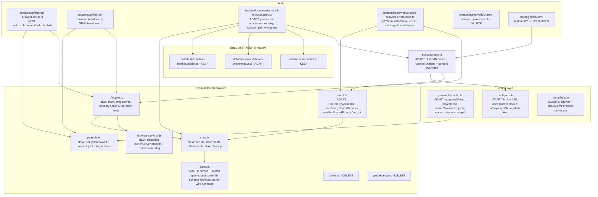
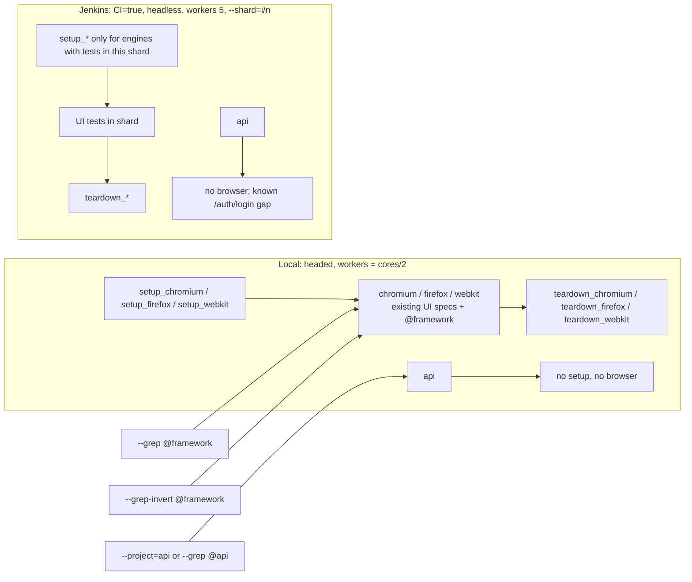

# Shared Browser per Project (isolated context per test): Code Change Plan

Slug: `shared-browser-per-project` · Stage B (planning), orchestration run 2, cycle 1 · Date: 2026-09-30 · Status: **Draft, awaiting SDET approval**
Requirements: `docs/requirements/shared-browser-per-project-requirements.md` (**Revision 1**, AC-1 to AC-20, S-1 to S-11)
Orchestration log: `docs/reports/shared-browser-per-project-orchestration-log.md`
Supersedes: the 2026-09-29 plan (runner-process broker started from `globalSetup`). That design is withdrawn by the SDET's
revised requirement ("dependencies function ... setup_chromium ... Remove the global setup function").
Next step after approval: `code-implementation-agent` / `make-code-changes docs/plans/shared-browser-per-project-plan.md`

---

## 1. Overview

**Goal.** Each UI project (`chromium`, `firefox`, `webkit`) runs **one browser instance per test run (per shard)**.
That instance is started by the project's own **setup project** (`setup_chromium`, `setup_firefox`, `setup_webkit`),
which is declared as a `dependencies` entry of the UI project. It is stopped by a paired **teardown project**
(`teardown_<engine>`, linked through the setup project's `teardown` property). Every worker of the project connects to
that instance. Every test still gets a **brand-new `BrowserContext` and `Page`** from Playwright's unchanged built-in
`context`/`page` fixtures. `globalSetup`/`globalTeardown` are removed.

**Chosen design in one paragraph.** A setup-project test cannot own the browser itself. Each test runs inside a
worker process, and the setup worker is torn down before the dependent project's workers start (prototype P-0: the
dependent test got `ECONNREFUSED` and the browser pid was dead). So `setup_<engine>` **spawns a small, detached,
loopback-only Node process** (`fixtures/shared-browser/browser-server.mjs`). That process calls
`browserType.launchServer({ host: '127.0.0.1', headless, channel, args, executablePath })` with the project's resolved
launch settings. It writes `{ status: 'ready', wsEndpoint, serverPid, browserPid, ... }` atomically to a per-run,
per-project state file under `os.tmpdir()/playwright-shared-browser/<runnerPid>/`, and then stays alive. The setup test
waits for that file, connects once to prove the endpoint works, and then passes. In every worker of the UI project, the
worker-scoped **`connectOptions` option fixture is overridden** to return that project's `wsEndpoint`. Playwright's own
built-in `browser` fixture then takes its supported `connect()` path (`node_modules/playwright/lib/index.js` lines
216-231). The built-in `context`/`page`, device emulation, `baseURL`, trace, video, screenshot and retries are
untouched. `teardown_<engine>` sends SIGTERM to the server, which closes the browser gracefully and removes its state
file. **Orphan safety does not depend on teardown running.** In Playwright 1.62.1, teardown projects do **not** run on
Ctrl+C, SIGTERM, SIGKILL or `--global-timeout` (P-6, P-7). So the server polls the runner pid every second and shuts
itself down when the runner is gone. The next run's setup also deletes stale run directories.

**Why the runner pid is the run identity.** Every worker (setup, UI and teardown) is a direct child of the runner
process, so `process.ppid` is identical across them and unique per concurrent run (P-1: `ppid=70490` in setup, probes
and teardown). No env var, no global hook and no nondeterministic value in `playwright.config.ts` is needed. That
matters because Playwright evaluates the config once per process (`types/test.d.ts` line 384, "do not dynamically
produce non-stable values").

**In scope:** requirements §2. **Out of scope:** requirements §2 exclusions. That means no worker-count change (the SDET's
`workers: process.env.CI ? 5 : undefined` stays **byte-identical**), no cross-project or cross-shard sharing, no `api`
behaviour change and no new application coverage.

**Headed-codegen exploration rule: why there is nothing to explore (requirements §12).**
`.ai/context/ui-automation-workflow.md` requires headed `npx playwright codegen` exploration of every page a UI flow
touches before any locator is planned. This change automates **no application page flow and plans no locators**. It is a
runner/fixture infrastructure change. The verification tests only render content they serve themselves: a
`context.route()`-fulfilled HTML stub at the reserved, never-resolving origin `https://shared-browser.invalid/` (RFC 2606),
or no page at all. There is no real page to record, so `docs/exploration/shared-browser-per-project-codegen.ts` is
intentionally **not** produced. The intent of the rule (observe real behaviour before writing code, never guess) was
met by a **headed**, live prototype (§3) against all three real engines, run with the sandbox override. It printed and
asserted every runtime behaviour this plan relies on. Per the caller's instruction it lives only in the session
scratchpad, not in the repo.

## 2. Inputs received

| Input | Source | Summary |
|---|---|---|
| Behaviour / acceptance | Requirements Rev 1 | AC-1 to AC-20, S-1 to S-11. One shared browser per UI project per run/shard via `setup_<project>` dependency projects. Fresh context per test. No global setup/teardown. The old mechanism is removed (AC-19). Setup/teardown tests are tagged (AC-20) |
| Open questions Q-1 to Q-5, A-1 to A-10 | Requirements §11 | All non-blocking. **Defaults adopted:** A-1 one running server per project that workers connect to. A-2 all three engines (all three proved feasible, P-2). A-3 always on, no toggle. A-4 CI `workers: 5` kept. A-5 `--ui`/`--debug`/IDE must still execute tests. A-6 `@regression @framework`. A-7 loopback-only, runtime-only connection details. A-8 recorded as observed (§3, P-5). A-9 exact names `setup_chromium`/`setup_firefox`/`setup_webkit`. A-10 no global teardown either |
| Orchestrator design guidance | Caller prompt | Detached `launchServer` process + state file + `connect` + teardown project. **Verified, not taken on trust** (§3). Adopted, with three corrections from the evidence: (1) teardown projects don't run on interrupt, so a runner-pid watchdog is mandatory; (2) `browser.isConnected()` is still `true` right after a crash, so attribution waits briefly for a verdict; (3) WebKit's `server.process()` is a `bash` launcher wrapper, so crash/kill logic targets the process group |
| Uncommitted working tree | `git status`, caller | Run 1's broker implementation. Disposition in §6.0 |
| Feature docs / API docs | n/a | None. No app or API endpoints involved |
| Tagging | Requirements §8, A-6, AC-20 | Verification tests: `@regression` + `@framework` + unique tag. Setup/teardown tests: `@framework` + unique per-engine tag |
| Installed versions | `package.json`, `node_modules` | `@playwright/test` 1.62.1, `playwright-core` 1.62.1, TypeScript strict `module: commonjs`, ESLint 10 flat config, local Node v26.10.0, README states Node 22+. No version pin is introduced |

## 3. Exploration findings: verified API facts and prototype evidence

### 3a. Installed-source facts (Playwright 1.62.1)

| Fact relied on | Evidence |
|---|---|
| Built-in `browser` fixture is worker-scoped and, **when `connectOptions` is truthy, calls `playwright[browserName].connect(wsEndpoint, {...})` instead of launching**. Its teardown `browser.close()` only disconnects this client | `node_modules/playwright/lib/index.js` lines 216-231 |
| `connectOptions` is a worker-scoped `option: true` fixture (default `connectOptionsFromEnv() \|\| _optionConnectOptions`), so a worker fixture override is supported | same file, lines 197-199 |
| `headless`, `channel`, `launchOptions`, `browserName` are worker option fixtures, so a setup test can read the project's resolved launch settings **without launching anything** | same file, lines 192-196 |
| The `x-playwright-launch-options` header sent on connect is only honoured by `run-server`-style servers. A `launchServer` endpoint serves its single already-launched browser (P-2: all workers saw the same `browserPid`) | same file, line 225; P-2 |
| Project-level `grep`, `dependencies`, `teardown` are resolved into `testInfo.config.projects[*]`; `testInfo.config.globalSetup/globalTeardown` are `null` when unset | P-11 |
| Config is evaluated in every process, so it must not create per-run random values | `node_modules/playwright/types/test.d.ts` line 384 |

### 3b. Prototype (scratchpad only, sandbox override, **headed** unless marked `CI=1`, real browsers)

Prototype files: `<scratchpad>/proto/{playwright.config.ts, fixtures.ts, shared-browser/server.mjs, shared-browser/state.ts, setup/shared-browser.setup.ts, setup/shared-browser.teardown.ts, ui/probe.spec.ts, api/api.spec.ts}`
and `<scratchpad>/proto-inline/*`, with the repo's `node_modules` symlinked in. Every run used `PW_TEST_HTML_REPORT_OPEN=never`.

| # | Check | Command | Observed result |
|---|---|---|---|
| P-0 | Orchestrator premise: `launchServer` inside a setup-project test dies with the setup worker | `proto-inline`: `npx playwright test` (setup launches `chromium.launchServer`, dependent connects) | Setup worker pid 70437, dependent worker pid 70448 (different process). `browser alive? false`. `browserType.connect: WebSocket error: connect ECONNREFUSED`. **Premise confirmed. An in-worker server is not viable** |
| P-1 | Detached server, chromium, 2 workers | `npx playwright test --project=chromium --workers=2` | Setup worker 70491 had `ppid=70490`. Probes on workerIndex 1 (pid 70504) and 2 (pid 70505) both had `ppid=70490` and reported **serverPid 70492 / browserPid 70493**. Attachment registry `["1-70504","2-70505"]`. Teardown `serverAlive=false browserAlive=false`. Result: 7 passed, 3 skipped (on-demand tests). `pgrep server.mjs` was empty afterwards |
| P-2 | **All three engines, 4 workers, headed**, process census mid-run | `PROTO_SLOW=1 npx playwright test --workers=4 --grep "@probe\|@slow\|@writer\|@reader"`, plus `pgrep -P <server>` | Exactly **3 server processes, one browser root each**: chromium 70625 (151.0.7922.34, server 70620), firefox 70623 (153.0, server 70622), webkit 70624 (26.5, server 70621; the root is WebKit's `bash` launcher). The only other children were `ffmpeg` (server-side video recording). Chromium probes ran on workers 3/4/5 (4 attached), firefox on 7/8/9 (3 attached), webkit on 10/11 (2 attached), all reporting their project's single server/browser pid. The three pids were distinct (AC-2). Device emulation worked: Desktop Chrome/Firefox showed a Windows UA on macOS, viewport 1280x720 on all engines. Writer/reader isolation passed on all 3 engines (cookie, localStorage, sessionStorage, geolocation permission `prompt`, leaked route `unreachable`). Result: 21 passed plus 3 intentional 30 s timeouts |
| P-2b | Artifacts on failure (AC-12) | same run | `test-failed-1.png`, `video.webm`, `trace.zip`, `error-context.md` produced for chromium, firefox and webkit. The attribution check did **not** fire on these ordinary failures (`state=ready`), so there is no false blame |
| P-3 | Crash mid-run (AC-14 b), each engine | `CI=1 PROTO_CRASH=1 PROTO_FAIL=1 npx playwright test --project=<e> --workers=1 --grep "@crash\|@fail\|@setup\|@teardown"`. The test runs `process.kill(-browserPid, 'SIGKILL')` | chromium 160 ms, firefox 360 ms, webkit 313 ms: `page.waitForTimeout: Browser closed` **plus** `[shared-browser] shared <e> browser for project "<e>" (server pid N) is crashed: <e> browser process exited unexpectedly`. The next test in the project failed in **0 ms** with the same attributable error. Teardown passed. No orphans. **Findings:** (a) immediately after the crash `browser.isConnected()` was still `true` and the state still `ready` (first attempt, before the fix). The verdict arrives milliseconds later, so attribution must wait, bounded, for it. (b) Killing only `server.process().pid` on WebKit killed the `bash` wrapper and **not** WebKit (the test passed). Kill logic must target the process group (`-pid`) |
| P-4 | Setup cannot launch (AC-14 a) | `CI=1 PROTO_FAIL_LAUNCH=firefox npx playwright test --workers=4 --grep "@probe\|@setup\|@teardown"` (firefox `executablePath: '/nonexistent/browser'`) | `[setup_firefox]` **failed** after 356 ms with `[shared-browser] setup_firefox: could not start the shared firefox browser: Failed to launch firefox because executable doesn't exist at /nonexistent/browser`, plus the server log line. The summary was `1 failed · 3 did not run · 11 passed`: the firefox tests **did not run** and did not hang, and chromium and webkit were unaffected. `teardown_firefox` still ran (nothing to stop). No orphans |
| P-5 | Subset runs (AC-9, AC-13, A-8) | `--project=api`; `--grep @api-proto`; `--project=chromium --grep @probe-a`; `--shard=1/3`, `2/3`, `3/3` | api-only: only `[api]` ran, **no setup project, no server**. `--grep` matching only API tests: **no setup project ran** (A-8 preferred outcome). chromium-only: `setup_chromium`, the test and `teardown_chromium` only. Shards: 1/3 → setup/teardown for chromium + firefox only; 2/3 → firefox + webkit; 3/3 → api + webkit. Setup/teardown tests are **not** counted in the shard split; they run in every shard that has a dependent test. The CLI `--grep` does **not** filter dependency projects (the setup ran although its tags didn't match), but the project-level `grep` still selected the right engine's test |
| P-6 | Interrupts (AC-7, R-8) | `<scratchpad>/interrupt.sh`: runner started in its own process group, then (a) `kill -INT -<pgid>` (terminal Ctrl+C), (b) `kill -TERM <runner>`, (c) `kill -KILL <runner>`, while 3 servers were running | In all 3 cases **teardown projects did not run** (0 `teardown_` lines), yet every server and browser root was gone within **≤ 2 s**. Server logs said `shutting down: runner pid N is gone` (the watchdog). Afterwards `pgrep ms-playwright` = 0 and `pgrep server.mjs` = 0 |
| P-7 | `--global-timeout` | `CI=1 PROTO_SLOW=1 npx playwright test --workers=4 --grep @slow --global-timeout=10000` | `Timed out waiting 10s for the teardown for test suite to run`, so teardown was skipped, and 0 processes were left afterwards (watchdog) |
| P-8 | Stale-state cleanup | same run as P-7, after P-6's SIGKILL left run dir `71979` | Every setup logged `stale removed: ["71979"]`. The three concurrent setups removing it at once caused no error (`rm -rf` with `force: true`) |
| P-9 | Retry (AC-12, S-9) | `CI=1 PROTO_FAIL=1 npx playwright test --project=webkit --grep @fail --retries=1 --trace=on-first-retry` | The retry ran in a new worker with a new context, still on the same server. `trace.zip` was present only under `-retry1`. JUnit has separate `<testsuite>`s for `setup/shared-browser.setup.ts` (hostname `setup_webkit`) and the teardown file (hostname `teardown_webkit`) (R-9) |
| P-10 | `--last-failed`, `--no-deps`, `--list` (R-10) | as named | `--last-failed` re-ran the failed test **plus** `setup_webkit`/`teardown_webkit` automatically. `--no-deps --project=chromium` failed fast (0 ms) with `[shared-browser] no shared browser state for project "chromium" (did setup_chromium run?)`. `--list` shows the setup/teardown tests but **not** the dependency wiring, so S-11 needs the config-inspection test TC-8 |
| P-11 | Wiring is inspectable at run time | throwaway spec printing `testInfo.config` | `globalSetup= null globalTeardown= null`. `chromium deps=["setup_chromium"]`, `setup_chromium teardown="teardown_chromium"` (same for the other two), `api deps=[]` |
| P-12 | Type-check of the plain-JS server script under repo compiler settings | `tsc -p tsconfig.check.json` (repo options + `allowJs`, `checkJs`) | First attempt failed with `TS1378: Top-level 'await' ... only allowed when 'module' is es2022...` (repo uses `module: commonjs`). After wrapping the script in `async function main()` + `main().catch(...)`: **exit 0** under `strict` + `noUncheckedIndexedAccess` |
| P-13 | Headless, all engines, 4 workers, after P-12 | `CI=1 npx playwright test --workers=4 --grep "@probe\|@writer\|@reader"` | `21 passed`. No orphans |

**Not verifiable locally:** the Linux Docker image `mcr.microsoft.com/playwright:v1.62.1-noble` (no Docker here), Playwright
UI mode (`--ui`) and `--debug` (both interactive). See §11.

**Locators table:** not applicable. No application locators are planned.

## 4. Diagrams

### 4a. Structure (new / adapted / deleted)



### 4b. Workflow (runtime sequence and assertion points)

```mermaid
sequenceDiagram
  participant R as Runner (pid R)
  participant SW as setup_chromium worker
  participant S as browser-server.mjs (detached, 1 per project)
  participant B as Chromium (child of S)
  participant W1 as chromium worker A
  participant W2 as chromium worker B
  participant TW as teardown_chromium worker
  R->>SW: run setup_chromium (dependency of chromium)
  SW->>SW: removeStaleRunDirs(); stop previous server of this run/project if any
  SW->>S: spawn(process.execPath, [browser-server.mjs, json], detached, stdio->log file)
  S->>B: chromium.launchServer({host:'127.0.0.1', headless, channel, args, executablePath})
  S-->>SW: state file <tmp>/playwright-shared-browser/R/chromium.json {status:'ready', wsEndpoint, serverPid, browserPid}
  Note over SW: ASSERT ready within 60 s (else SharedBrowserError with cause + log tail); connect() once, isConnected, version; headless matches
  SW--xR: setup worker exits (S survives: detached)
  R->>W1: chromium tests (setup passed)
  W1->>W1: sharedBrowser fixture: readReadySharedBrowser('chromium'), register attachment "workerIndex-pid"
  W1->>B: built-in browser fixture: connect(wsEndpoint) via overridden connectOptions
  W2->>B: connect(same wsEndpoint)
  W1->>B: built-in context fixture: newContext(device opts) per test, closed after
  Note over W1,W2: ASSERT probes: same serverPid/browserPid/wsEndpoint as state, >=2 attachments, pid distinct from other projects; isolation pair: new clean context
  loop every 1 s
    S->>R: kill(R, 0) - if runner gone: close browser, delete state, exit
  end
  alt browser crashes
    B--xS: close event -> S writes {status:'crashed', error} and exits
    Note over W1: context override (failed test with "closed" error): wait for verdict (<=5 s) -> throw SharedBrowserError
    W2->>W2: next worker start: readReadySharedBrowser throws "crashed" (0 ms)
  end
  R->>TW: teardown_chromium (after all chromium tests)
  TW->>S: SIGTERM -> S closes browser (10 s, then kill), removes state, exits
  Note over TW: ASSERT state file gone within 15 s (fallback SIGKILL of process groups); log summary line
```

### 4c. Execution (tags/projects → where tests run)



## 5. Test-case matrix

UI verification tests live under `tests/ui/framework/`, so the existing `testMatch: 'ui/**/*.spec.ts'` runs them on
chromium, firefox and webkit. Setup/teardown tests live under `tests/setup/`, matched only by the setup/teardown projects.
None touch an external site.

| ID | Scenario | Type | Data | Assertions | Tags | Project(s) | Source |
|---|---|---|---|---|---|---|---|
| SU-1..3 | `setup_<engine>` starts the project's shared browser | positive (lifecycle) | engine row from `SHARED_BROWSER_NAMES` | `startSharedBrowserServer` resolves within `SHARED_BROWSER_START_TIMEOUT_MS`. The state is `ready`, `browserName` equals the project's, `headless` equals the `headless` fixture. A one-off `connect()` returns `isConnected() === true` and a non-empty `version()`, then disconnects | `@framework`, `@setup-shared-browser-<engine>` | `setup_<engine>` | AC-1, AC-2, AC-10, AC-18, AC-20; S-1, S-2, S-7; P-1/P-2 |
| TD-1..3 | `teardown_<engine>` stops it | positive (lifecycle) | engine row | `stopSharedBrowserServer` reports `stopped` or `not-running`. Afterwards the project's state file and attachment dir no longer exist. The summary line is logged | `@framework`, `@teardown-shared-browser-<engine>` | `teardown_<engine>` | AC-7, AC-20; S-7; P-1 |
| TC-1 | Probe A: this test's browser is the project's single shared instance, used by ≥ 2 workers | positive / state | `SHARED_BROWSER_PROBES[0]`, Faker marker | Skip (reason) if `testInfo.config.workers < 2`. `connectOptions.wsEndpoint === state.wsEndpoint` (proves the built-in fixture took the connect path, P-1). `browser.browserType().name() === browserName`. `browser.contexts()` equals `[context]`. Clean state before writing the marker. Poll `listAttachedWorkers(project)` until ≥ 2 distinct `workerIndex` values (`CROSS_WORKER_WAIT_MS`), else skip with reason. `state.serverPid` is not equal to any **other** project's `serverPid` present in this run dir (AC-2). Only its own marker is visible afterwards. An identity annotation is added | `@regression @framework @shared-browser-across-workers-probe-a` | chromium, firefox, webkit | AC-1, AC-2, AC-4, AC-5, AC-6; S-1, S-2, S-4, S-6 |
| TC-2 | Probe B (a second probe, so ≥ 2 workers join even when the file runs alone) | as TC-1 | `SHARED_BROWSER_PROBES[1]` | as TC-1 | `@regression @framework @shared-browser-across-workers-probe-b` | all 3 UI | as TC-1 |
| TC-3 | First test in a worker writes cookie + localStorage + sessionStorage + geolocation grant + context route | state (writer) | Faker marker, `STATE_PROBE_ORIGIN` | **Unchanged from run 1**: `browser.contexts()` is `[context]`, clean before writing, readback sanity, `LEAKED` served, context reference and `close` listener stored | `@regression @framework @isolated-context-first-test-writes-state` | all 3 UI | AC-3, AC-4; S-3, S-5, S-6; P-2 |
| TC-4 | Next test on the **same worker** gets a new, clean context | state (reader) / negative | same | **Unchanged**: `context !== previous`, previous emitted `close`, no cookies/storage, permission `prompt`, leak probe not `LEAKED` | `@regression @framework @isolated-context-next-test-starts-clean` | all 3 UI | AC-3, AC-4; S-3, S-5, S-6 |
| TC-5 | Setup cannot start the shared browser → attributable failure, no hang | negative / error path | private key `private-launch-failure-<engine>`, `NONEXISTENT_BROWSER_EXECUTABLE` | `startSharedBrowserServer({ projectName: private key, browserName, launchOptions: { headless: true, executablePath: NONEXISTENT } })` rejects with a `SharedBrowserError` whose message contains `[shared-browser]`, the private project name, the engine and `doesn't exist`, within `SHARED_BROWSER_START_TIMEOUT_MS`. Afterwards no process from it is alive and the private state is removed (`finally` → `stopSharedBrowserServer`). **No browser is launched**, so AC-1's one-browser census is untouched | `@regression @framework @shared-browser-launch-failure-reported` | all 3 UI (no `page`) | AC-14; S-10(a); P-4 |
| TC-6 | A crashed shared browser is reported attributably | negative / error path | private key `private-crash-<engine>`, crafted `crashed` state written with `writeSharedBrowserState` | `readReadySharedBrowser(private key, browserName)` throws `SharedBrowserError` matching `/shared \w+ browser for project "private-crash-\w+" \(server pid \d+\) .*exited unexpectedly/`. `waitForSharedBrowserVerdict` on that key resolves to `crashed` immediately. The state is cleaned in `finally`. The end-to-end real crash stays a scripted verification (V-9), because killing the real shared browser would fail every in-flight test of the project | `@regression @framework @shared-browser-crash-reported` | all 3 UI (no `page`) | AC-14; S-10(b); P-3 |
| TC-7 | Missing state (e.g. `--no-deps`, or setup not run) is reported attributably | negative | private key `private-missing-<engine>` (never written) | `readReadySharedBrowser` throws `SharedBrowserError` containing `did setup_private-missing-<engine> run?` | `@regression @framework @shared-browser-missing-state-reported` | all 3 UI (no `page`) | AC-14; P-10 |
| TC-8 | Project wiring: own setup dependency, paired teardown, api untouched, no global hooks | structural | `testInfo.config` | For its own UI project `p`: `p.dependencies` equals `['setup_<p>']`. Project `setup_<p>` exists with `teardown === 'teardown_<p>'` and no dependencies. No other project depends on `setup_<p>`. Project `api` has `dependencies` `[]`. `testInfo.config.globalSetup === null` and `globalTeardown === null` | `@regression @framework @shared-browser-project-wiring` | all 3 UI (no `page`) | AC-9, AC-18, AC-19; S-11; P-11 |

**Parametrization.** TC-1/TC-2: `for (const probe of SHARED_BROWSER_PROBES)` (existing data rows, own tags). SU/TD:
`for (const engine of SHARED_BROWSER_NAMES)` in each file, with the per-engine tag from `setupTag(engine)`/`teardownTag(engine)`.
Each setup/teardown project selects its own engine's test through its project-level `grep` (P-5 showed this still works when
the CLI `--grep` doesn't match). TC-3/TC-4 stay a `mode: 'serial'` pair. That is the only Playwright-guaranteed way to get
consecutive tests on the same worker (S-5). TC-5 to TC-8 are distinct scenarios.

**Manual/scripted evidence, not automated tests (with reason):** AC-7 interrupts (need an external kill of the runner),
the real mid-run crash (it would fail the project's other in-flight tests), and AC-8/10/12/13 before/after and subset runs.
All are scripted in §10.

**Candidate cases (needs confirmation, not planned):**
- An automated real-crash test in a dedicated, serial, browser-private project. It would add a 5th project type and an extra browser.
- An "exactly one browser process per engine" census test using `ps`. It is OS-specific and covered by V-6.

## 6. Code change list

### 6.0 Disposition of existing uncommitted work

`git status` at planning time. **Keep** = no change. **Adapt** = edit as described in 6.x. **Delete** = remove the file
(it exists only for the global-setup/broker mechanism, AC-19).

| Path | Status in tree | Disposition | Reason |
|---|---|---|---|
| `.env.example` | modified | **Adapt (revert to HEAD)** | The only change is the `PW_SHARED_BROWSER_BROKER_URL ... set automatically ... by fixtures/shared-browser/global-setup.ts` comment. That var and file no longer exist, and the new design adds **no** env setting (A-3, AC-15) |
| `README.md` | modified | **Adapt** | The structure list and "Execution model" section describe the broker/globalSetup. Rewrite per §6.12 (AC-16). All `global-setup`/`broker`/`PW_SHARED_BROWSER_BROKER_URL` mentions go (AC-19). The CI paragraph's "if CI runs with 1 worker" caveat is replaced (CI is 5) |
| `config/env.ts` | modified | **Adapt** | Delete `SHARED_BROWSER_BROKER_URL_VAR`, `brokerUrlSchema`, `setSharedBrowserBrokerUrl`, `getSharedBrowserBrokerUrl` (broker-only). **Keep** `isPlaywrightDebugMode()`, which is still used for the `--debug` fallback (Q-5) |
| `fixtures/index.ts` | modified | **Adapt** | Keep the pattern (override `connectOptions`, keep built-in `browser`/`context`/`page`), but source the endpoint from the state file instead of the broker HTTP API. Remove the broker imports/stats calls. See §6.6 |
| `playwright.config.ts` | modified | **Adapt** | Remove the `globalSetup` line and its comment (AC-19). Replace the three UI project entries with `sharedBrowserProjects(...)` triplets. **Keep the SDET's `workers: process.env.CI ? 5 : undefined` line and every other line byte-identical** |
| `data/builders/state-marker.builder.ts` | untracked | **Keep** | Mechanism-independent Faker marker used by TC-1 to TC-4 |
| `data/framework/shared-browser.data.ts` | untracked | **Adapt** | Keep `STATE_PROBE_ORIGIN`, `STATE_MARKER_PREFIX`, `LEAK_PROBE_PATH`, `LEAKED_BODY`, `LEAK_PROBE_UNREACHABLE`, `CROSS_WORKER_WAIT_MS`, `SHARED_BROWSER_PROBES`. Update the header comment (it points to the old plan §6.7). Add the private keys and the nonexistent executable constant (§6.9) |
| `fixtures/shared-browser/broker.ts` | untracked | **Delete** | Runner-process HTTP broker, only meaningful with `globalSetup` |
| `fixtures/shared-browser/client.ts` | untracked | **Adapt** | Keep `SharedBrowserError`, `toSharedBrowserName`, `SHARED_BROWSER_CONNECT_TIMEOUT_MS`. Delete the HTTP functions (`callBroker`, `acquireSharedBrowser`, `fetchSharedBrowserStats`, `fetchAllSharedBrowserStats`) and the broker timeouts. Add the state-file readers (§6.4) |
| `fixtures/shared-browser/global-setup.ts` | untracked | **Delete** | It is the global setup function the SDET asked to remove |
| `fixtures/shared-browser/types.ts` | untracked | **Adapt** | Keep `SHARED_BROWSER_NAMES`, `sharedBrowserNameSchema`, `SharedBrowserName`, `sharedBrowserLaunchOptionsSchema` (+ `executablePath`). Delete the broker wire schemas (`sharedBrowserAcquireRequestSchema`, `sharedBrowserSessionSchema`, `sharedBrowserStatusSchema`, `sharedBrowserProjectStatsSchema`, `sharedBrowserErrorBodySchema`). Add the state-file schemas (§6.2) |
| `tests/ui/framework/shared-browser.spec.ts` | untracked | **Adapt** | Probe logic swaps broker stats for the attachment registry/state file. The isolation pair TC-3/TC-4 is kept verbatim. Add TC-8. Remove the `getSharedBrowserBrokerUrl`/`fetch*Stats` imports and the `requireBrokerUrl` helper |
| `tests/ui/framework/shared-browser-broker.spec.ts` | untracked | **Delete** | It unit-tests `SharedBrowserBroker` with a fake launcher, i.e. only the removed mechanism (AC-19). Its two scenario tags are re-homed on the new mechanism in `shared-browser-errors.spec.ts` (TC-5, TC-6). The tags stay unique because the old file is gone |
| `utils/browser-state.ts` | untracked | **Keep** | Mechanism-independent cookie/storage/permission/route helpers (DOM-free typing, verified in run 1) |

New files: `fixtures/shared-browser/{browser-server.mjs, state.ts, lifecycle.ts, projects.ts}`,
`tests/setup/{shared-browser.setup.ts, shared-browser.teardown.ts}`, `tests/ui/framework/shared-browser-errors.spec.ts`.
Modified tracked file not in the tree yet: `tsconfig.json`.

After implementation, this must return nothing (AC-19):
`grep -rn "globalSetup\|global-setup\|broker\|BROKER_URL" --include=*.ts --include=*.mjs --include=*.md --include=.env.example . --exclude-dir=node_modules --exclude-dir=docs`

### 6.1 `fixtures/shared-browser/browser-server.mjs` (create), principles a, g, i

A plain ESM JavaScript file, not TypeScript. It is executed by a bare `node` (`process.execPath`) outside the Playwright
transpiler. Plain JS removes any dependency on Node's type stripping, whose availability differs between Node 22 minors
(README says "Node.js 22+"). Type-checked through `// @ts-check` + JSDoc + `tsconfig.json` `checkJs` (P-12).
- Header comment: purpose, "spawned only by `lifecycle.ts`; do not run by hand", and the state-file contract (the shape must match `sharedBrowserStateSchema` in `types.ts`).
- `argv[2]` is JSON `{ projectName, browserName, launchOptions: { headless?, channel?, args?, executablePath? }, statePath, runnerPid, watchIntervalMs, closeTimeoutMs }`.
- **No top-level await** (TS1378 under `module: commonjs`). Use `async function main()` + `main().catch(...)`, which logs `fatal` and exits 1.
- `launchServer({ ...launchOptions, host: '127.0.0.1', handleSIGINT: false, handleSIGTERM: false, handleSIGHUP: false })`.
  Never set `wsPath` (keep Playwright's unguessable default) and never bind a non-loopback host (A-7).
- On launch error, write `{ status: 'failed', error, serverPid, runnerPid, projectName, browserName }` and exit 1.
- On success, write `{ status: 'ready', wsEndpoint, serverPid: process.pid, browserPid: server.process().pid, runnerPid, projectName, browserName, headless }`.
- State writes are **atomic** (`writeFileSync(tmp, json, { mode: 0o600 })` + `renameSync`).
- `server.on('close')` (not initiated by shutdown) writes `{ status: 'crashed', error: '<browserName> browser process exited unexpectedly' ... }` and exits.
- `SIGTERM`/`SIGINT`/`SIGHUP` → graceful shutdown: `server.close()` raced against `closeTimeoutMs` (10 s), then `server.kill()`. Remove the state file, exit 0. Re-entrancy guarded.
- **Runner watchdog:** `setInterval(watchIntervalMs = 1000)` calls `process.kill(runnerPid, 0)`. On `ESRCH` it shuts down (P-6/P-7).
- Log lines (to its stdout/stderr, redirected to the per-project log file): `ready browserPid=... headless=...`, `shutting down: <reason>`, `launch failed: <msg>`. **Never log `wsEndpoint`.**

### 6.2 `fixtures/shared-browser/types.ts` (adapt), principles a, c, i

- Keep `SHARED_BROWSER_NAMES`, `sharedBrowserNameSchema`, `SharedBrowserName`.
- `sharedBrowserLaunchOptionsSchema = z.object({ headless: z.boolean().optional(), channel: z.string().optional(), args: z.array(z.string()).optional(), executablePath: z.string().optional() })`.
  Doc comment: the JSON-serializable subset of the project's `launchOptions` forwarded to `launchServer`. `slowMo`, `logger`, `env` and other client-side or non-serializable fields are not forwarded.
- New `sharedBrowserStateSchema = z.discriminatedUnion('status', [ready, failed, crashed])`:
  - `ready: { status: 'ready', projectName, browserName, wsEndpoint: z.string().startsWith('ws://127.0.0.1:'), serverPid, browserPid, runnerPid, headless: z.boolean().optional() }`
  - `failed | crashed: { status, projectName, browserName, serverPid, runnerPid, error: z.string() }`
  - Export `SharedBrowserState`, `ReadySharedBrowserState`.
- New `sharedBrowserServerArgsSchema` (the argv JSON above) and type, so `lifecycle.ts` builds it type-safely.
- Delete all broker wire schemas (§6.0).

### 6.3 `fixtures/shared-browser/state.ts` (create), principles a, c, g, i

Filesystem layer, shared by setup, workers and teardown. No `process.env` access (`os.tmpdir()` is Node's own lookup).
- `SHARED_BROWSER_STATE_ROOT = path.join(os.tmpdir(), 'playwright-shared-browser')`. Outside the repo, so nothing can be committed (A-7). Directories are created with `mode: 0o700`.
- `currentRunnerPid(): number` returns `process.ppid`. Doc comment: every Playwright worker is a direct child of the runner (P-1). In UI/IDE mode it is the test-server pid, which is fine because setup stops any previous server of the same key first.
- `runDir(runnerPid = currentRunnerPid())`, `statePath(projectName, runnerPid?)`, `serverLogPath(projectName, runnerPid?)`, `attachmentsDir(projectName, runnerPid?)`.
- `readSharedBrowserState(projectName, runnerPid?): SharedBrowserState | undefined`. `undefined` if the file is absent. Throws `SharedBrowserError` if the file is present but fails `sharedBrowserStateSchema`.
- `writeSharedBrowserState(state)`: atomic, `0o600` (used by TC-6 and kept in parity with the `.mjs` writer).
- `removeSharedBrowserFiles(projectName, runnerPid?)`: state, log, attachments. Then removes the run dir if empty (ignore `ENOTEMPTY`).
- `registerWorkerAttachment(projectName, workerIndex, pid)` writes an empty file `<workerIndex>-<pid>`. `listAttachedWorkers(projectName): Array<{ workerIndex: number; pid: number }>`, parsed and de-duplicated by `workerIndex`.
- `listSharedBrowserStates(runnerPid?)`: every state in this run dir (TC-1's AC-2 distinctness check).
- `isProcessAlive(pid)`: `process.kill(pid, 0)`, where `EPERM` counts as alive.
- `removeStaleRunDirs(): string[]` removes run dirs whose numeric name is a dead pid and is not `currentRunnerPid()`. It is idempotent under concurrent callers (`rm` with `force: true`, P-8). It **never kills** processes, because the watchdog already guarantees server exit and killing by recorded pid risks pid reuse.

### 6.4 `fixtures/shared-browser/client.ts` (adapt), principles a, g, h

Worker-side readers plus the error type.
- Keep `SharedBrowserError` (`[shared-browser]` prefix) and `toSharedBrowserName`.
- Keep `SHARED_BROWSER_CONNECT_TIMEOUT_MS = 30_000`. Add `SHARED_BROWSER_VERDICT_TIMEOUT_MS = 5_000`.
- `readReadySharedBrowser(projectName: string, browserName: SharedBrowserName): ReadySharedBrowserState`. It throws `SharedBrowserError`:
  - absent: `No shared browser for project "<p>" in this run: did setup_<p> run? (it is skipped by --no-deps)`
  - `failed`: `Shared <engine> browser for project "<p>" failed to start: <error>`
  - `crashed`: `Shared <engine> browser for project "<p>" (server pid <n>) is crashed: <error>`
  - `ready` but server not alive: `... (server pid <n>) is no longer running`
  - engine mismatch: `... state is for <x>, project uses <y>`
- `waitForSharedBrowserVerdict(browser: Browser, projectName: string, timeoutMs = SHARED_BROWSER_VERDICT_TIMEOUT_MS): Promise<'ready' | 'crashed' | 'failed' | 'gone' | 'disconnected'>`.
  Resolves as soon as the state leaves `ready`, the file disappears, or `browser` emits `disconnected`. Implemented with `browser.once('disconnected')` and `fs.watch` on the run dir, raced against a single timeout. **No polling sleeps.** Resolves `'ready'` on timeout. Needed because `isConnected()` is still `true` for a few ms after a crash (P-3a).

### 6.5 `fixtures/shared-browser/lifecycle.ts` (create), principles a, b, g, h

Used only by the setup/teardown tests and TC-5. Test bodies stay a single call plus assertions (no conditionals in tests).
- `SHARED_BROWSER_START_TIMEOUT_MS = 60_000` (cold start plus CI headroom; observed about 0.4 to 0.9 s locally),
  `SHARED_BROWSER_STOP_TIMEOUT_MS = 15_000`, `SHARED_BROWSER_WATCH_INTERVAL_MS = 1_000`, `SHARED_BROWSER_CLOSE_TIMEOUT_MS = 10_000`.
- `SERVER_SCRIPT = path.join(__dirname, 'browser-server.mjs')`.
- `startSharedBrowserServer(opts: { projectName: string; browserName: SharedBrowserName; launchOptions: SharedBrowserLaunchOptions; timeoutMs?: number }): Promise<ReadySharedBrowserState>`
  1. `removeStaleRunDirs()`. Then `await stopSharedBrowserServer(projectName)` if a state exists for this run/project (setup retry, UI mode rerun).
  2. `mkdir` `runDir` (0o700), open the log fd, then `spawn(process.execPath, [SERVER_SCRIPT, JSON.stringify(args)], { detached: true, stdio: ['ignore', fd, fd] })` and `unref()`. Validate `args` with `sharedBrowserServerArgsSchema` first.
  3. Wait (event-driven: `fs.watch` on the run dir plus the child's `exit` event, bounded by `timeoutMs`) for a state file or a child exit.
  4. `ready`: return it. `failed`: throw `SharedBrowserError('setup_<p>: could not start the shared <engine> browser: <error>\n<last 20 log lines>')`. Child exited without state: the same, with the exit code. Timeout: kill the child's process group, then throw `... did not become ready within <n> ms`.
- `stopSharedBrowserServer(projectName): Promise<{ result: 'stopped' | 'not-running' | 'killed'; attachedWorkers: number; status?: string; serverPid?: number }>`
  - No state: `not-running`. State `failed`/`crashed`, or a server that is not alive: remove the files, then return `not-running` with the status.
  - Otherwise send `SIGTERM` to `serverPid` and wait for the state file to disappear within `SHARED_BROWSER_STOP_TIMEOUT_MS`. Wait on the file, **not** the pid: in a Jenkins `docker` agent without `--init` the reparented server can linger as a zombie, which `kill(pid, 0)` reports as alive. Fallback: `SIGKILL` `-browserPid` and `-serverPid` (process groups, P-3b), then `killed`.
  - Always `removeSharedBrowserFiles`.
- `formatSharedBrowserSummary(projectName, result)` returns one line, e.g. `[shared-browser] chromium: stopped chromium server (pid 123), 4 workers attached`. The setup counterpart is `[shared-browser] chromium: started chromium 151.0.7922.34 (server pid 123, browser pid 124, headless=false)`. Logged through `utils/logger` as CI-log evidence (principle h).

### 6.6 `fixtures/index.ts` (adapt), principles a, b, g

- Imports: remove `getSharedBrowserBrokerUrl`, `acquireSharedBrowser`, `fetchSharedBrowserStats`, `SHARED_BROWSER_ACQUIRE_TIMEOUT_MS`. Add `readReadySharedBrowser`, `waitForSharedBrowserVerdict`, `SHARED_BROWSER_CONNECT_TIMEOUT_MS`, `toSharedBrowserName`, `SharedBrowserError` from `./shared-browser/client`, and `registerWorkerAttachment` from `./shared-browser/state`.
- `WorkerFixtures.sharedBrowser: ReadySharedBrowserState | null`. Rename from `sharedBrowserSession`. `null` only under `--debug`/`PWDEBUG`.
- Worker fixture `sharedBrowser: [async ({ browserName }, use, workerInfo) => ..., { scope: 'worker' }]`:
  - `isPlaywrightDebugMode()`: log `--debug/PWDEBUG detected: using a per-worker browser for Inspector compatibility`, then `use(null)`.
  - Otherwise `const state = readReadySharedBrowser(workerInfo.project.name, toSharedBrowserName(browserName))`, then `registerWorkerAttachment(workerInfo.project.name, workerInfo.workerIndex, process.pid)`, then `use(state)`.
  - Lazy by construction: only instantiated via `connectOptions` → `browser`, i.e. by tests using `browser`/`context`/`page`. `api` never touches it (P-5).
- Override worker option fixture `connectOptions: [async ({ sharedBrowser }, use) => use(sharedBrowser ? { wsEndpoint: sharedBrowser.wsEndpoint, timeout: SHARED_BROWSER_CONNECT_TIMEOUT_MS } : undefined), { scope: 'worker' }]`. **Do not** override `browser`.
- Override test fixture `context: async ({ context, sharedBrowser, browser }, use, testInfo) => { await use(context); ... }`. The after-part runs only when `sharedBrowser` is set, `testInfo.status !== testInfo.expectedStatus` **and** some `testInfo.errors[].message` matches `/browser has been closed|Browser closed|Target .*closed/i`. It then calls `waitForSharedBrowserVerdict(browser, project)`. If the verdict is not `ready`, re-read the state and throw `SharedBrowserError` with the `readReadySharedBrowser` message (+ ` during this test`). Ordinary assertion failures pay zero cost and get no false blame (P-2b). Errors from the verdict check itself are caught and `logger.warn`ed, so they never mask the test's own error.
- Doc comment on `test`: the execution model (setup project → one server per UI project → worker connect → new context per test), and that specs importing `@playwright/test` directly bypass it.
- The existing fixtures (`authToken`, `exampleClient`, `authenticatedPage`, `testData`, `sauceDemoAuthenticatedPage`) are unchanged.
- Re-export `SharedBrowserError` and the type `ReadySharedBrowserState`. Remove the `SharedBrowserSession`/`SharedBrowserProjectStats` re-exports.

### 6.7 `fixtures/shared-browser/projects.ts` (create) and `playwright.config.ts` (adapt), principles b, c, f, j

`projects.ts` has no Playwright runtime import, only `import type { Project } from '@playwright/test'`. It must stay light
because the config is loaded in every process.
- `SHARED_BROWSER_SETUP_FILE = 'setup/shared-browser.setup.ts'`, `SHARED_BROWSER_TEARDOWN_FILE = 'setup/shared-browser.teardown.ts'` (relative to `testDir`).
- `setupProjectName(p) => \`setup_${p}\``, `teardownProjectName(p) => \`teardown_${p}\`` (A-9 exact underscore form).
- `setupTag(p) => \`@setup-shared-browser-${p}\``, `teardownTag(p) => \`@teardown-shared-browser-${p}\``.
- `sharedBrowserProjects(name: SharedBrowserName, use: Project['use'], testMatch: string): Project[]` returns, in this order:
  1. `{ name: setup_<name>, testMatch: SETUP_FILE, grep: new RegExp(\`${escape(setupTag(name))}\\b\`), teardown: teardown_<name>, use }`
  2. `{ name: teardown_<name>, testMatch: TEARDOWN_FILE, grep: ...teardownTag..., use }`
  3. `{ name, testMatch, dependencies: [setup_<name>], use }`
  Doc comment: why `use` is repeated (the setup test reads `browserName`/`headless`/`channel`/`launchOptions` from it) and why teardown runs are not guaranteed (P-6/P-7) and the watchdog covers that.

`playwright.config.ts`:
- Remove `/* One shared browser per UI project ... */` and `globalSetup: './fixtures/shared-browser/global-setup.ts'`.
- `projects: [...sharedBrowserProjects('chromium', { ...devices['Desktop Chrome'] }, 'ui/**/*.spec.ts'), ...firefox, ...webkit, { name: 'api', ... unchanged }]`, with a comment pointing to README "Execution model".
- Everything else (`testDir`, `fullyParallel`, `forbidOnly`, `retries`, **`workers: process.env.CI ? 5 : undefined` and its existing comment**, `reporter`, `use`) stays byte-identical.

### 6.8 `config/env.ts` (adapt), principle c
Remove the broker block (§6.0). Keep `isPlaywrightDebugMode()` and its doc comment, reworded so it no longer mentions the broker. The file's diff vs HEAD is then only that function.

### 6.9 `data/framework/shared-browser.data.ts` (adapt), principles b, e
Keep the existing exports (§6.0). Update the header to reference this plan §5. Add:
- `PRIVATE_LAUNCH_FAILURE_PREFIX = 'private-launch-failure-'`, `PRIVATE_CRASH_PREFIX = 'private-crash-'`, `PRIVATE_MISSING_PREFIX = 'private-missing-'` (suffixed with the engine in the spec, so three concurrent projects never share a key).
- `NONEXISTENT_BROWSER_EXECUTABLE = '/nonexistent/shared-browser-probe'`.
- `CRASHED_BROWSER_ERROR` (the crafted TC-6 error text), `FAKE_DEAD_SERVER_PID = 2 ** 22 + 1` (above default `pid_max` on macOS/Linux, so it is never a live pid).

### 6.10 Tests

**`tests/setup/shared-browser.setup.ts` (create).** `import { test as setup, expect } from '../../fixtures'`. Use the repo
fixtures entry for consistency. The setup test requests no `browser`/`page`, so no connect is attempted.
`for (const engine of SHARED_BROWSER_NAMES)`:
`setup(\`starts the shared ${engine} browser for the ${engine} project\`, { tag: ['@framework', setupTag(engine)] }, async ({ browserName, headless, channel, launchOptions, playwright }, testInfo) => { ... })`.
- `setup.setTimeout(SHARED_BROWSER_START_TIMEOUT_MS + 15_000)`.
- `const project = uiProjectFromSetupName(testInfo.project.name)` (in `projects.ts`; throws on a bad name).
- `const state = await startSharedBrowserServer({ projectName: project, browserName: toSharedBrowserName(browserName), launchOptions: { headless, channel, args: launchOptions.args, executablePath: launchOptions.executablePath } })`.
- `expect(state.browserName).toBe(browserName)`, `expect(state.headless).toBe(headless)`.
- `const probe = await playwright[browserName].connect(state.wsEndpoint)`, then `expect(probe.isConnected()).toBe(true)`, `expect(probe.version()).not.toBe('')`, `await probe.close()`.
- `logger.info(<setup summary>)` and `testInfo.annotations.push({ type: 'shared-browser', description: 'project=... engine=... serverPid=... browserPid=... headless=...' })`. Do not include the `wsEndpoint`.

**`tests/setup/shared-browser.teardown.ts` (create).** `for (const engine of SHARED_BROWSER_NAMES)`:
`teardown(\`stops the shared ${engine} browser after the ${engine} project\`, { tag: ['@framework', teardownTag(engine)] }, async ({}, testInfo) => { const r = await stopSharedBrowserServer(uiProjectFromTeardownName(testInfo.project.name)); logger.info(format...); expect(readSharedBrowserState(project)).toBeUndefined(); })`.

**`tests/ui/framework/shared-browser.spec.ts` (adapt).**
- Probes (TC-1/TC-2): replace `requireBrokerUrl`/`fetch*Stats` with `listAttachedWorkers(projectName)` (the `expect.poll(...).then(() => true, () => false)` rendezvous is unchanged) and `listSharedBrowserStates()` for AC-2 distinctness. Request `connectOptions` and assert `connectOptions?.wsEndpoint === sharedBrowser.wsEndpoint`. Assert `sharedBrowser.browserName === browserName`. Keep the two runtime `test.skip`s with their justified eslint-disable comments. Update the skip reason text: `Cross-worker sharing needs >= 2 workers; this run uses 1 (--workers=1).` and `Only one worker executed <project> tests in this run/shard, so cross-worker sharing cannot be demonstrated.` Annotation: `project, engine, serverPid, browserPid, workerIndex, attachedWorkers`.
- Isolation pair (TC-3/TC-4): unchanged.
- TC-8 `'wires the project to its own setup_<project> dependency with no global setup'`. Test-body logic only. Use `testInfo.config.projects.find(...)`, with assertions only (no `if`).
- The file header comment references this plan §5 and drops the "globalSetup" wording.

**`tests/ui/framework/shared-browser-errors.spec.ts` (create).** No `page`/`context`/`browser` fixture, so it runs in milliseconds.
TC-5 `'reports a shared browser that cannot start as a failed setup with its cause'`; TC-6 `'reports a crashed shared browser with the project, engine and server pid'`;
TC-7 `'reports a missing shared browser and points at the setup project'`. Each uses `try/finally` → `removeSharedBrowserFiles(privateKey)` / `stopSharedBrowserServer(privateKey)`.

### 6.11 `tsconfig.json` (modify), principle d
Add `"allowJs": true, "checkJs": true` and extend `include` to `["**/*.ts", "fixtures/shared-browser/browser-server.mjs"]`.
This is the only JS file brought under `tsc` (`eslint.config.mjs` stays excluded). Verified in P-12.
**ESLint:** no config change. The flat config lints `*.mjs` with its default (no-rule) set, so it parses cleanly. Prettier covers it via `format:check`.

### 6.12 `README.md` (adapt), principle d
- Project structure: `fixtures/shared-browser/` → `browser-server.mjs` (detached server), `lifecycle.ts`, `state.ts`, `client.ts`, `projects.ts`, `types.ts`. Add `tests/setup/` (setup/teardown projects), `tests/ui/framework/`, `data/framework/`, `utils/browser-state.ts`.
- Remove the `PW_SHARED_BROWSER_BROKER_URL` paragraph.
- Rewrite **"Execution model: one shared browser per UI project"**:
  - `setup_<engine>` (a dependency of `<engine>`) starts one loopback-only browser server per project per run/shard. All the project's workers connect to it. `teardown_<engine>` stops it. There is **no global setup or teardown**.
  - A new context and page per test.
  - `--project=api` or `--grep` selecting only API tests starts no browser. `--project=chromium` starts only Chromium. Each shard starts only the engines it has tests for (P-5).
  - Reports: setup/teardown appear as extra entries `[setup_chromium] starts the shared chromium browser ...` and `[teardown_chromium] ...` and in test counts. They are infrastructure, not app coverage (R-9).
  - Interrupted runs: teardown projects don't run on Ctrl+C/abort/global timeout, but each server exits within about 1 s once the runner is gone. Leftover state in `<tmp>/playwright-shared-browser/` is cleaned by the next run.
  - `--no-deps` is not supported for UI projects (fails fast with a `did setup_<p> run?` error). `--debug`/`PWDEBUG` uses a per-worker browser.
  - Crash: every in-flight test in that project fails with a `[shared-browser] ... crashed` error. There is no relaunch. Other projects are unaffected.
  - Headed locally: one browser app per engine, with test windows inside it. The existing WebKit/`caffeinate` note is kept.
  - Specs must import from `fixtures/`.
- Verification commands: `npx playwright test --grep @framework` and `--project=chromium --grep @framework`. Explain when the cross-worker probes skip (`--workers=1`, or a shard in which only one worker ran that project's tests).
- CI paragraph: replace the broker/"1 worker" sentences with: each build/shard runs `setup_*`/`teardown_*` for its engines, logs one `[shared-browser] ... started` and one `... stopped` line per engine, needs no new credentials, and runs 5 workers, so the cross-worker probes execute.

### 6.13 `.env.example` (adapt): revert to HEAD (remove the 2 broker comment lines). No new variable.

### 6.14 `Jenkinsfile`: **no change** (principle j)
Same image (`v1.62.1-noble`, all three browsers), loopback inside the container, no credentials, the sharding
parameters are unchanged. Jenkins abort = SIGTERM then SIGKILL to the runner, and both are orphan-free via the watchdog
(P-6, macOS). Linux is confirmed on the first CI run (§11 R-1). Optional hardening, **not** required: `args '--init'` on the docker agent to reap reparented processes (see §9).

### 6.15 `to_be_automated.md`: no change.

### 6.16 Learnings (for the learnings stage; not a code file)
Proposed bullets for `.ai/context/automation-pipeline-learnings.md`:
- (a) A browser launched (even `launchServer`) inside a setup-project test dies with the setup worker. Dependents get `ECONNREFUSED` (P-0). Cross-worker shared browsers need a detached process.
- (b) In 1.62.1, **teardown projects do not run** on Ctrl+C, SIGTERM, SIGKILL or `--global-timeout` (P-6/P-7). Never rely on them alone for cleanup.
- (c) The CLI `--grep` does not filter dependency projects, but project-level `grep` does. Setup/teardown tests are not counted in `--shard` splits and run in every shard that needs them (P-5).
- (d) WebKit's `BrowserServer.process()` is a `bash` launcher wrapper. Kill the process group, not the pid (P-3b).
- (e) After a remote browser crash, `browser.isConnected()` stays `true` for a few ms. Wait for `disconnected` before attributing (P-3a).
- (f) `module: commonjs` + `checkJs` rejects top-level `await` in `.mjs` (TS1378). Wrap in `main()` (P-12).

## 7. Tagging plan

| Test | Tags |
|---|---|
| SU-1/2/3 | `@framework`, `@setup-shared-browser-chromium` / `-firefox` / `-webkit` |
| TD-1/2/3 | `@framework`, `@teardown-shared-browser-chromium` / `-firefox` / `-webkit` |
| TC-1 | `@regression`, `@framework`, `@shared-browser-across-workers-probe-a` |
| TC-2 | `@regression`, `@framework`, `@shared-browser-across-workers-probe-b` |
| TC-3 | `@regression`, `@framework`, `@isolated-context-first-test-writes-state` |
| TC-4 | `@regression`, `@framework`, `@isolated-context-next-test-starts-clean` |
| TC-5 | `@regression`, `@framework`, `@shared-browser-launch-failure-reported` |
| TC-6 | `@regression`, `@framework`, `@shared-browser-crash-reported` |
| TC-7 | `@regression`, `@framework`, `@shared-browser-missing-state-reported` |
| TC-8 | `@regression`, `@framework`, `@shared-browser-project-wiring` |

- All tags use the `tag` option array (`.ai/context/test-tagging.md`). The setup/teardown classification tag is `@framework`
  (infrastructure). They are deliberately **not** `@regression`, so `--grep @regression` doesn't select them as primary tests.
  They still run as dependencies wherever needed (P-5). Unique per engine (AC-20).
- Collision check done during planning: `grep -rn "setup-shared-browser\|teardown-shared-browser\|shared-browser-project-wiring\|shared-browser-missing-state" tests data` → no matches.
  TC-5/TC-6 reuse the two tags of the deleted broker spec. They remain unique once that file is deleted. The implementer re-runs the grep.
- Existing tests' titles and tags are unchanged (AC-8).
- Subsets: `--grep @framework` (all infra checks + setup/teardown), `--grep-invert @framework` (the app suite; setup/teardown still run as dependencies), `--grep @shared-browser-across-workers` (both probes), any unique tag alone.

## 8. Test data & security

- Synthetic, per-call random markers (`buildStateMarker`). No app data, no credentials, **no new env var or secret** (AC-15).
- Exposure (A-7): `launchServer` binds to `127.0.0.1` with the unguessable default `wsPath`. The state dir is outside the
  repo under `os.tmpdir()` (dirs `0o700`, files `0o600`). The `wsEndpoint` is never logged, annotated or attached to reports.
  Only pids, engine and version are logged.
- The spawned server inherits the setup worker's environment (it needs `DISPLAY`/`PLAYWRIGHT_BROWSERS_PATH` etc.). It prints no environment.
- Stub origin `https://shared-browser.invalid/` is fulfilled by `context.route`. No request leaves the machine.

## 9. Reliability notes

- **Readiness:** dependency ordering guarantees setup finished before any UI worker starts. `readReadySharedBrowser` is synchronous and needs no waits.
- **Waiting strategy:** setup waits on `fs.watch` + child `exit`, teardown on `fs.watch`, attribution on `browser.once('disconnected')`. All are bounded, and none use `waitForTimeout`/sleep loops (principle g).
- **Timeouts:** start 60 s (setup test timeout 75 s), connect 30 s, verdict 5 s (failed-with-"closed" tests only), stop 15 s then kill.
- **Crash policy:** fail fast, no relaunch (keeps AC-1's single-launch invariant). Blast radius: every in-flight test in that project (requirements R-6). CI retries fail again quickly with the same attributable error, and other projects are unaffected (P-3, P-4).
- **Orphans (AC-7):** three layers. (1) teardown project (normal/failed runs); (2) runner-pid watchdog in the server (interrupts, global timeout, runner crash; ≤ 2 s, P-6/P-7); (3) stale run-dir cleanup at the next setup (P-8). Browsers are children of the server, which closes/kills them before exiting. Chromium/Firefox/WebKit also exit on pipe close if the server is SIGKILLed.
- **Zombies in Jenkins Docker:** the Jenkins `docker {}` agent's PID 1 is `cat`, which doesn't reap. A server that exits after its parent (the setup worker) is gone may remain a **zombie** (no CPU/memory, only a pid entry) until the container is removed at the end of the build. Teardown therefore waits on the state file, not the pid. Optional `args '--init'` removes this.
- **Probe rendezvous:** it counts **every** worker that attached to the project (via the registry), not only probes. So a skip happens only if exactly one worker ran that project's tests in this run/shard. With default workers (5 on a 10-core Mac) and CI 5, P-2 showed 2 to 4 workers per project. Sharded CI with many shards can leave a project with one worker in a shard. The probe then skips with the reason (documented, R-3).
- **Isolation:** built-in `context` fixture unchanged. Proven by TC-3/TC-4 (serial, same worker) and TC-1/TC-2 (concurrent, different workers, same browser).
- **ESLint:** conditional `test.skip` keeps its justified `playwright/no-skipped-test` disables. Setup/teardown bodies have no conditionals (logic lives in `lifecycle.ts`).
- **Specs that bypass `fixtures/`** (e.g. `tests/seed.spec.ts`, outside every `testMatch`) would launch a per-worker browser. All current specs import from `fixtures/`. `PW_TEST_CONNECT_WS_ENDPOINT` is superseded (documented).

## 10. Verification plan

Every `npx playwright test` runs **with the sandbox override from the start**, with `PW_TEST_HTML_REPORT_OPEN=never`.

| Step | Command | Expected |
|---|---|---|
| V-1 | `npx tsc --noEmit` | clean (includes `browser-server.mjs` via `checkJs`) |
| V-2 | `npx eslint playwright.config.ts config/env.ts fixtures data/framework data/builders/state-marker.builder.ts utils/browser-state.ts tests/setup tests/ui/framework` | 0 errors, 0 warnings |
| V-3 | `npx prettier --check <same files> tsconfig.json README.md .env.example` | clean |
| V-4 | AC-19 grep (§6.0) + `git status` shows `broker.ts`, `global-setup.ts`, `shared-browser-broker.spec.ts` gone | no matches |
| V-5 | Baseline vs. after, same day (R-2): `git stash`-free approach: record the current HEAD outcome first with `git worktree add <scratch> HEAD` + `npx playwright test --reporter=list` there, then the after-run in the repo | same outcome for all pre-existing tests (AC-8) |
| V-6 | Per engine, headed: `npx playwright test --grep @framework --project=<e> --workers=2 --reporter=list`, with `pgrep -fl browser-server.mjs` in a second shell mid-run | setup + 8 tests + teardown pass. Probes **pass** (not skipped). One server process for `<e>`, one browser root |
| V-7 | All engines, headed: `npx playwright test --grep @framework --reporter=list` | 3 setup + 24 + 3 teardown pass. 3 distinct server pids in the `started` log lines (AC-2) |
| V-8 | CI mode: `CI=1 npx playwright test --reporter=list` (5 workers, headless) | pre-existing outcomes unchanged (known `/auth/login` gap). `@framework` all pass, **probes execute** (AC-6) |
| V-9 | Real crash (S-10 b), scratch spec **not committed**: kills `-sharedBrowser.browserPid` mid-test, `--project=<e> --workers=1`, for all 3 engines | in-flight test has the `[shared-browser] ... crashed` error. The next test fails in ~0 ms with the same error. Teardown passes. Delete the scratch spec |
| V-10 | Launch failure end to end (S-10 a): temporary local edit `launchOptions: { executablePath: '/nonexistent' }` on the firefox project, **reverted** afterwards | `setup_firefox` failed with cause, firefox tests "did not run", chromium/webkit pass, no hang |
| V-11 | Interrupts (AC-7): run the suite in the background. Once 3 `started` lines appear, (a) SIGINT to the process group, (b) SIGTERM to the runner, (c) SIGKILL to the runner. Then `pgrep -fl "browser-server.mjs\|ms-playwright"` after 3 s, then a normal run | nothing left. The next run starts cleanly and logs stale-dir removal |
| V-12 | Subsets (AC-9, AC-13): `--project=api` (and `pgrep browser-server.mjs` mid-run = 0); `--grep @api`; `--project=chromium`; `--shard=1/3`, `2/3`, `3/3` | as in P-5 |
| V-13 | `--workers=1 --grep @shared-browser-across-workers` | both probes **skipped** with the AC-6 reason. Isolation still passes |
| V-14 | Artifacts (AC-12): inspect `test-results/` of a failing test (V-9/V-10 or a deliberately failing scratch test with `--retries=1`) | `trace.zip`, `video.webm`, `test-failed-*.png`. Retry in a new context |
| V-15 | Tags: `grep -rn "setup-shared-browser\|teardown-shared-browser\|@shared-browser-\|@isolated-context-" tests fixtures \| sort` | each unique tag defined once |
| V-16 | `--ui` smoke (Q-5), manual/optional | a `@framework` test executes. Reported as not verified if no human is present |

## 11. Risks, assumptions, open questions

**Risks**
- **R-1 Linux/Docker not verified locally.** Mitigation: first Jenkins build. Check 3 `started`/`stopped` lines, green
  `@framework`, and executed probes. A WebKit-in-Docker failure is a blocker per A-2. Report it, do not exempt the engine.
- **R-2 Teardown projects are skipped on interrupt** (P-6/P-7). Covered by the watchdog and stale cleanup. The residual gap: if the
  runner pid is reused by another process within the 1 s poll window, the server stays up until that pid ends. That is extremely unlikely.
- **R-3 Probe skip in heavily sharded CI.** It skips with a reason, never passes vacuously. Unsharded CI (default `1/1`) with 5 workers executes it.
- **R-4 `--ui`, IDE and `--debug` not verified** (interactive). `--debug` falls back to per-worker browsers (logged). In UI/IDE mode the
  run dir is keyed by the long-lived test-server pid. Setup stops a previous server of the same key, and the watchdog ends it when the UI closes.
- **R-5 Blast radius** of one browser per project (requirements R-6). Accepted, and loud.
- **R-6 Windows unsupported** (process-group signals). The repo targets macOS locally and Linux CI. Documented in the `lifecycle.ts` header.
- **R-7 Third-party drift** (playwright.dev, saucedemo.com). Before/after runs happen the same day (V-5).
- **R-8 Report shape** (setup/teardown entries in HTML/JUnit, P-9). Documented in README (AC-16).
- **Note (not changed):** the comment above the SDET's `workers` line ("Opt out of parallel tests on CI.") no longer matches
  `5`. It is left untouched as instructed. The SDET may want to reword it.

**Assumptions:** requirements A-1 to A-10 as stated in §2. Browsers are installed locally. `os.tmpdir()` is writable
(true on macOS and in the Playwright Docker image).

**Open questions (non-blocking; defaults applied)**
1. **Q-P1 Crash policy:** default (a) fail fast, no relaunch. Alternative: (b) relaunch once from the next worker, which weakens AC-1's single-launch evidence.
2. **Q-P2 `--debug`:** default (a) per-worker browser under `PWDEBUG`. Alternative: (b) always connect to the shared server (Inspector untested over `connect`).
3. **Q-P3 State location:** default (a) `os.tmpdir()/playwright-shared-browser`, which can never be committed and needs no `.gitignore` change. Alternative: (b) a gitignored repo-local dir, e.g. `playwright/.shared-browser/`.
